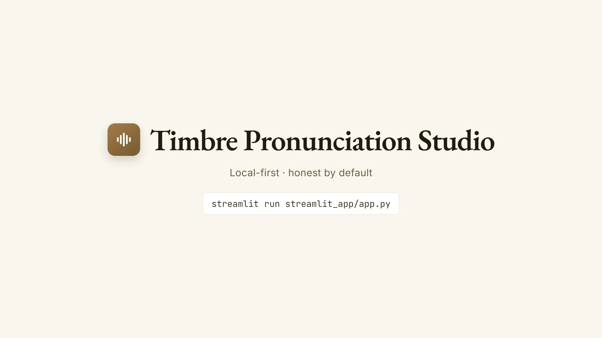
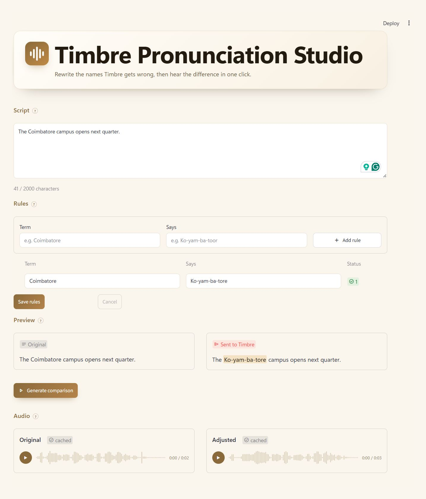

# Timbre Pronunciation Studio

**Fix how Gnani's Timbre says the names that matter — without touching the script.**

A local-first studio for reusable pronunciation rules on top of Gnani AI's
[Timbre](https://www.gnani.ai) text-to-speech API. Write a rule once
(`Timbre` → `Tim-ber`), apply it to any script, keep the canonical text
untouched, and hear the original and the adjusted clip from the same model,
voice, language and speed.

Built for the **Great Indian AI Internship Challenge**. Stack: Python 3.11, FastAPI,
Streamlit, pytest — one process, no build step, no paid services beyond the Gnani
API.

> **Honesty first.** This is application-side respelling, not phoneme or IPA
> control, and it makes no claim of measured accuracy: one listener judged eight
> English terms. Read [`docs/LIMITATIONS.md`](docs/LIMITATIONS.md) before relying
> on it.

## The 23-second film

[](https://github.com/user-attachments/assets/4348d670-af7d-42d0-9370-28e7eba05cbf)

## The problem

Any product whose copy names people, places or brands hits the same wall: the
voice announces *Bvlgari* wrong, in every call, every prompt, every
notification. The two workarounds are a support ticket per term, or editing the
source text so `Bvlgari` becomes `Bulgaree` on screen as well. Neither is
reusable, and the second leaks respellings into copy that customers read.

As of October 2026, Gnani's documentation offers custom pronunciations through a
point of contact; the public Timbre API has no self-service, user-managed
pronunciation dictionary. This app is that missing loop, built on the API as it
exists today.

## What it does

| Step | What you see |
|---|---|
| **1. Script** | A text area with a live character meter — a ring and a count that follow every keystroke; 800 characters is flagged, and anything above 2,000 is rejected before a request leaves the machine. |
| **2. Rules** | A table of term → says pairs, with add, edit, delete, duplicate and length validation. Each row shows how many times its term matches the current script. |
| **3. Preview** | Two columns. *Original* is your text. *Sent to Timbre* is the exact transformed string, with every whole-word match highlighted — same matching the engine uses, so nothing surprising is sent. |
| **4. Generate** | Two clips, same settings, side by side: original and adjusted. Waveform players, credit-safe caching, and a new script invalidates stale audio instead of showing it. |

Dictionaries are plain JSON in `data/` (gitignored), one file each; audio is cached
by content hash. A dictionary can be imported and exported as CSV, or downloaded
as a JSON backup, and a first-run sample dictionary carries the three rules that
passed the listening gate.

## Why the engineering looks like this

- **The rule engine is a pure function.** Single pass over the original string,
  longest source first, whole-word boundaries, case-insensitive match, replacement
  inserted verbatim. The script is never mutated, so the canonical text survives.
- **One process.** The Streamlit UI imports `backend/app/core/` in-process. No
  CORS, no proxy, no second server to demo. The FastAPI layer exists for HTTP
  clients, `/docs`, and the API tests.
- **Nothing is billed twice.** The cache key is a SHA-256 over text, model, voice,
  language, speed and format; one shared helper synthesises on a miss, and a lock
  keeps two threads from paying for the same clip. Writes go through a temp file
  and an atomic replace, so a crash cannot leave half a dictionary.
- **Failures are typed.** Thirteen error types map to status codes behind one JSON
  envelope, so the UI shows the reason, not a stack trace.
- **Tests never touch the network.** 170 tests run offline against stubs; none can
  spend a credit. The paid scripts refuse to run until a human types `spend`, and
  print the maximum number of calls first — [`AGENTS.md`](AGENTS.md) records that
  rule for any AI assistant working in the repo.

## Evidence

| Check | Result |
|---|---|
| Gate A — API works | **Passed 20 Oct 2026.** Both models returned audio. |
| Gate B — do rules actually help? | **Passed 21 Oct 2026.** 8 of 8 terms judged closer, 0 damaged, settings held constant. One listener, 8 English terms — a viability check, not an accuracy rate. Record: [`docs/evidence/gate-b-try_results.json`](docs/evidence/gate-b-try_results.json). |
| 800-character clip | Median 6.2 s and slowest 6.9 s over five samples, ≈4.7 MB — inside the 10 s target. |
| 2,000-character clip | Accepted in 9.2 s, so the 2,000-character limit is a verified ceiling, not a guess. 2,100 characters are rejected upstream in 133 ms. |
| Tests | **170 passing** — 147 backend, 23 UI. |
| End to end, real key | A new script generated with a rule applied, the bad-key banner appeared as designed, rules survived a restart, and a repeated Generate was served from cache at no cost. |

## Run it

Needs Python 3.10+ (tested on 3.11.9) and a Gnani API key with programme credits.

```bash
python -m venv .venv
.venv/Scripts/python.exe -m pip install -r backend/requirements.txt
cp backend/.env.example backend/.env      # then set GNANI_API_KEY
.venv/Scripts/python.exe -m streamlit run streamlit_app/app.py
```

Windows paths; on macOS or Linux use `.venv/bin/python`, and in PowerShell `cp`
is `Copy-Item`.

Open <http://127.0.0.1:8501>. The key only has to be **non-empty** to start, so a
placeholder (`GNANI_API_KEY=placeholder-not-a-real-key`) is enough to explore the
whole UI, edit dictionaries, and see the error state on Generate — no credits
spent. Audio is generated only when you ask for it, and only when it is not
already cached.

The API on its own, for `/docs` and the OpenAPI schema:

```bash
cd backend
../.venv/Scripts/python.exe -m app.main      # http://127.0.0.1:8000/docs
```

Tests:

```bash
.venv/Scripts/python.exe -m pytest backend streamlit_app/tests -q
```



*Captured with a scratch data folder and a placeholder key; both clips were
already cached, so no credits were spent.*

## The API

| Method | Path | Purpose |
|---|---|---|
| `GET` | `/api/health` | Liveness, plus `key_configured` as a boolean |
| `GET` | `/api/options` | Models, voices, fixed language and speed, limits |
| `GET` `POST` | `/api/dictionaries` | List / create |
| `PATCH` `DELETE` | `/api/dictionaries/{id}` | Rename / delete |
| `GET` `POST` | `/api/dictionaries/{id}/rules` | List / create |
| `PATCH` `DELETE` | `/api/rules/{id}` | Edit / delete |
| `POST` | `/api/transform` | Apply rules locally — no upstream call, no credits |
| `POST` | `/api/synthesize` | Generate audio, cached |
| `GET` | `/api/audio/{key}.wav` | Play cached bytes |

One error envelope everywhere:

```json
{ "success": false,
  "error": { "type": "VALIDATION_ERROR", "message": "Replacement cannot be empty.",
             "details": [{ "field": "replacement", "issue": "empty" }] } }
```

## Layout

```text
backend/app/
  main.py        app factory, error handlers, routers
  api/           health, options, dictionaries, rules, transform, synthesize, audio
  core/          pronunciation_rules, dictionary_store, audio_cache, gnani_tts, atomic
  config.py      env loading, limits, fail-fast key check
  models/        Pydantic wire models
  tests/         147 backend tests, all offline
streamlit_app/   the UI: app.py, seed.py, csv_io.py, 23 tests
scripts/         developer utilities — smoke test, POC matrix, respelling loop, limit probe
docs/            PRD, TRD, App Flow, UI/UX, Backend Schema, Implementation Plan, LIMITATIONS
```

## Team

| Person | Contribution |
|---|---|
| **Kshitij Mittal** | Product research and specifications (PRD, TRD, App Flow, UI/UX brief, Backend Schema, Implementation Plan); rule engine, FastAPI backend, dictionary store, TTS client, audio cache; Gate A/B probes and the limit measurements; the Streamlit UI as shipped (one `app.py` plus two small pure-Python helpers); the backend test suite and the shipped UI's tests; documentation. |
| **Pawni Gupta** | The first Streamlit studio (PR #1, 30 Oct): screens, rule table, preview, audio players, the state module and its four test files — the working front end that proved the flow end to end, later consolidated into the single `app.py` now on `main`. |

## Status and what's next

**Shipped and green:** the full workflow end to end, 170 offline tests, both gates
passed, limits measured, UI merged, the 23-second film recorded.

There is no hosted demo: the app is local-first by design, and the film above is
the real app running.

**Next:** the public post for the challenge. Deliberately out of scope, and listed
in `docs/LIMITATIONS.md`: authentication and multi-user, phoneme/IPA rules, other
languages, batch rendering, audio eviction.

## Docs

| Document | What it holds |
|---|---|
| [`PRD.md`](docs/PRD.md) | The problem, requirements, the Gate B stop condition |
| [`TRD.md`](docs/TRD.md) | Architecture, decisions and the alternatives that were rejected |
| [`Backend Schema.md`](docs/Backend%20Schema.md) | The wire contract, error taxonomy, storage format |
| [`App Flow.md`](docs/App%20Flow.md) | User journeys, states, guardrails |
| [`UI-UX Brief.md`](docs/UI-UX%20Brief.md) | The design system and the copy rules |
| [`Implementation Plan.md`](docs/Implementation%20Plan.md) | Milestones, owners, what was cut and why |
| [`LIMITATIONS.md`](docs/LIMITATIONS.md) | What this cannot do, stated plainly |
