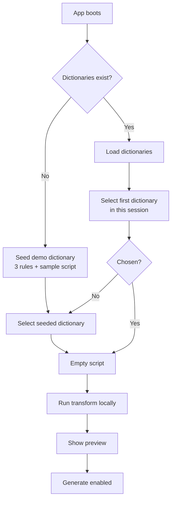
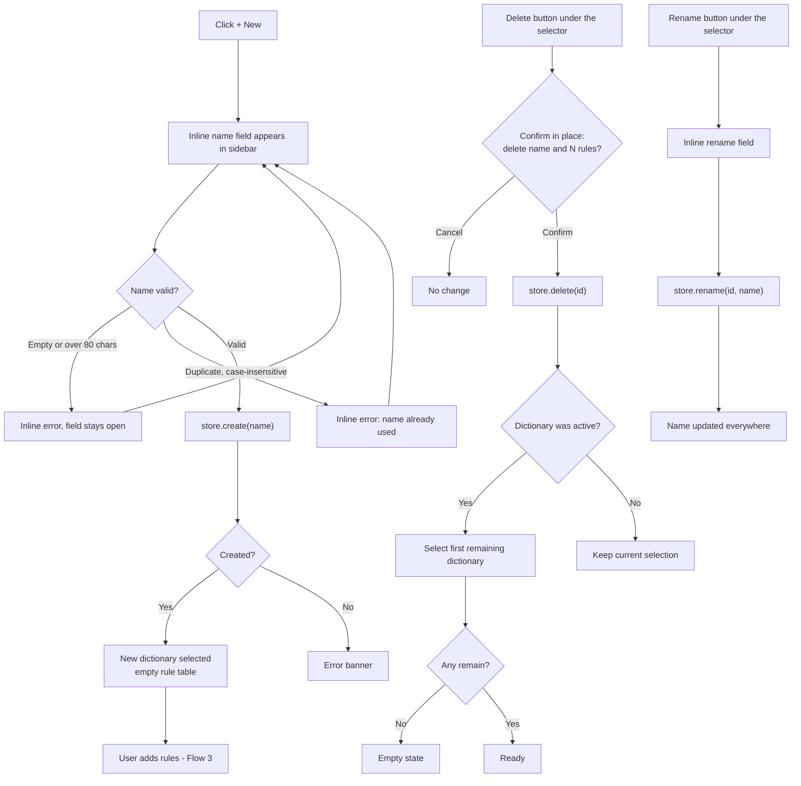
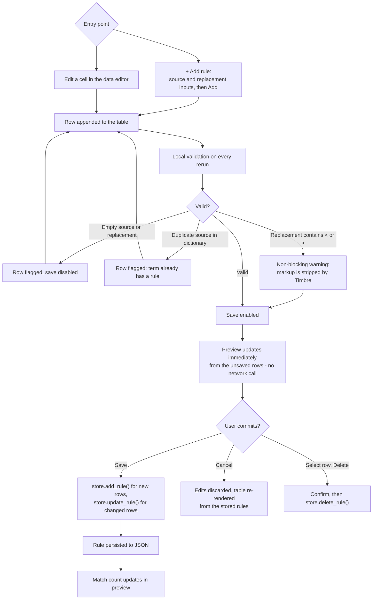
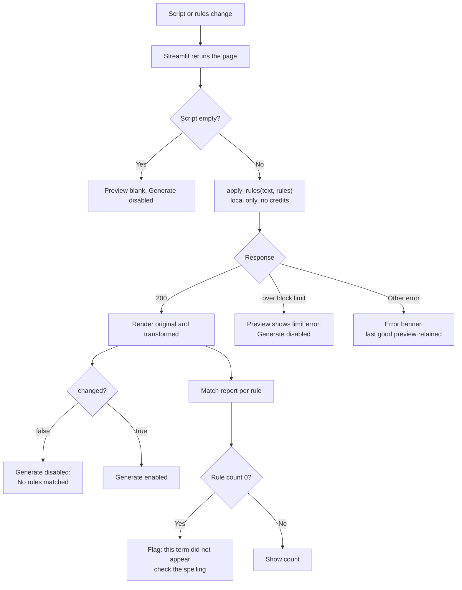
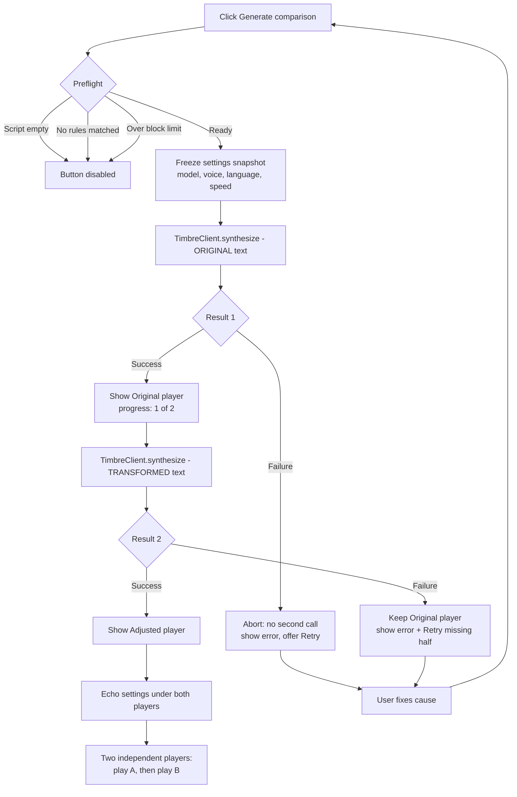
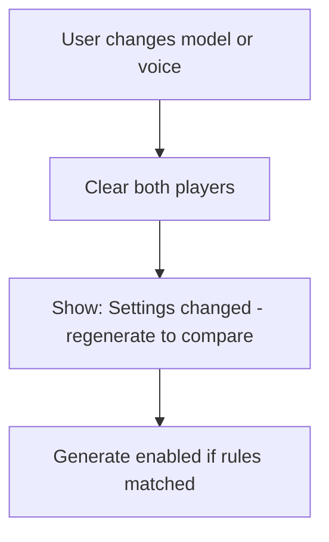
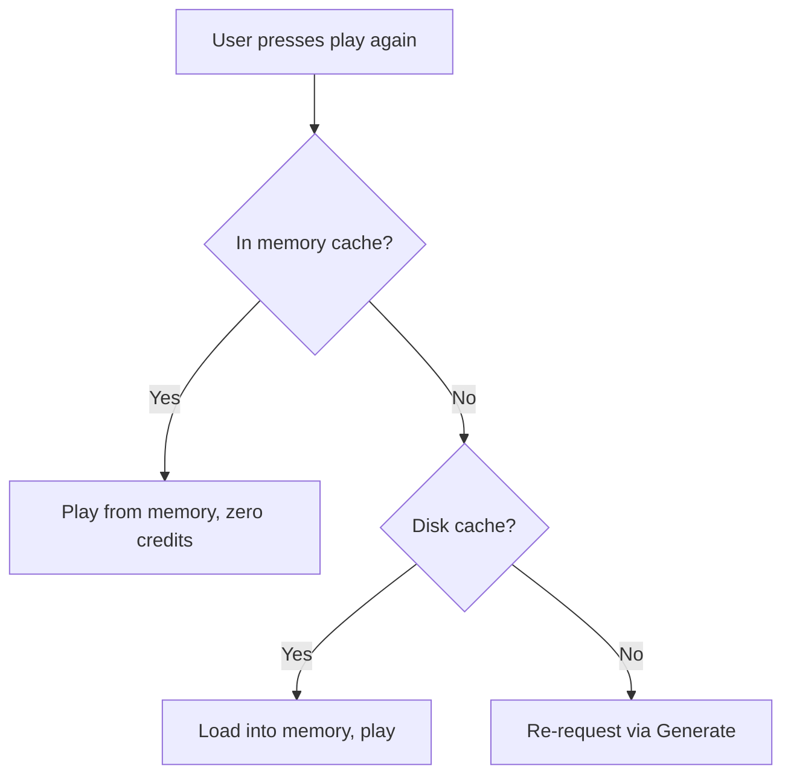
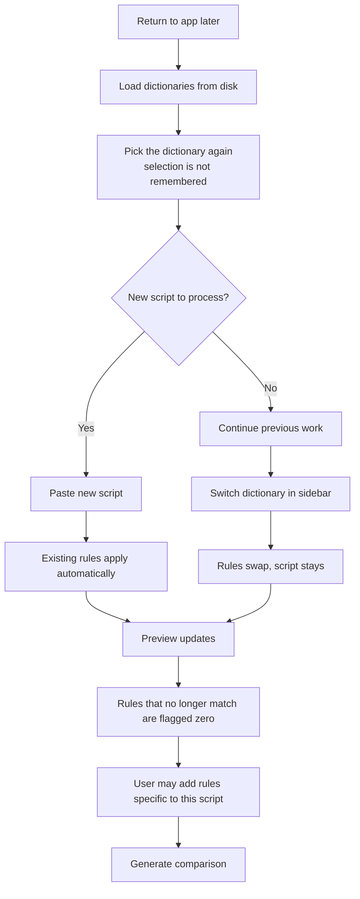
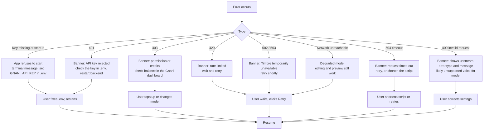
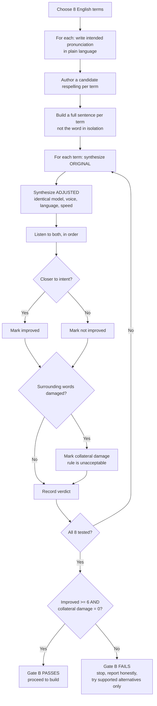

# Timbre Pronunciation Studio — App Flow

| Field | Value |
|---|---|
| Document | App Flow |
| Version | 1.0 |
| Date | 20 October 2026 |
| Status | Approved — amended 22 October 2026 for the Streamlit build |
| Parent documents | `docs/PRD.md` v1.0, `docs/TRD.md` v1.0 |
| Owners | [Teammate] — the Streamlit UI in `streamlit_app/`, which imports `backend/app/core/` directly; [You] — those `core/` modules. The HTTP layer in `backend/app/api/` is **not** used by the UI |
| Scope | User journeys from first launch to a completed before/after comparison |
| Amends | Rewritten 22 October 2026 for the Streamlit build (`TRD` §12); the previous flows described the rejected React layout |

---

## 1. Purpose

This document describes **how the user moves through the application**: what they see, what they click, what the system does in response, and where the flow can branch or fail.

It exists to prevent three specific failure modes:

1. **Dead ends.** A user reaching a state with no obvious next action.
2. **Silent ambiguity.** A user unable to tell whether a comparison was valid.
3. **Wasted credits.** A flow that calls the TTS API without an explicit, informed user action.

Every flow below traces to a PRD user story (§10).

---

## 2. Actors and entry points

| Actor | Entry | Goal |
|---|---|---|
| Developer (primary) | Opens the app before integrating Timbre | Define and verify a pronunciation rule for a product term |
| Creator (secondary) | Opens the app while preparing a script | Fix one or two problem words without re-recording |
| Demo viewer | Watches a recorded video | Understand the before/after difference in under 60 seconds |
| Reviewer (Gnani) | Runs the app or watches the video | Judge whether the gap and the fix are real |

**Entry point:** `http://localhost:8501`, the address `streamlit run streamlit_app/app.py` prints (`TRD` §16.2). There is no login, no landing page and no marketing screen. The app opens directly into the studio.

**How the UI reaches the engine:** it imports `backend/app/core/` inside the same
process. It does not call `:8000`, and a separately run HTTP API is only for
`/docs`. `Backend Schema` documents that optional surface; it is not a contract
for this UI.

---

## 3. Screen model

One page: a sidebar plus one main column. No router, no navigation stack, no
header bar, no theme toggle, no right-click menus — Streamlit owns that chrome
(`UI-UX Brief` §16.1).

```text
┌────────────────────┬───────────────────────────────────────────────┐
│  SIDEBAR           │  1. SCRIPT                                    │
│                    │     text_area + counter + limit state         │
│  Dictionaries      │───────────────────────────────────────────────│
│   [Gnani Demo  ▾]  │  2. RULES                                     │
│    3 rules         │     data editor: source | replacement         │
│   [+ New]          │     [+ Add rule]  [Save]  [Delete]            │
│   [Rename][Delete] │───────────────────────────────────────────────│
│                    │  3. PREVIEW                                   │
│  Voice settings    │     original | transformed (two columns)      │
│   Model   [v3.0 ▾] │     per-rule match report                     │
│   Voice   [Lakshmi]│───────────────────────────────────────────────│
│   Lang    en-IN    │  4. AUDIO                                     │
│   Speed   1.0 ×    │     [Generate comparison]                     │
│                    │     ▸ Original    ▸ Adjusted                  │
│  ── limitation     │     settings echo under both                  │
│     note           │                                               │
└────────────────────┴───────────────────────────────────────────────┘
```

**What the framework changes, and why the flows below are written this way:**

- **Dictionary actions are buttons, not menus.** Rename and Delete sit under the
  selector and act on the active dictionary; there is no right-click menu and no
  per-item overflow menu.
- **Rules are one `st.data_editor` table**, not inline editable rows. Cell edits
  are held by the widget until **Save**; **Cancel** re-renders the table from the
  stored rules.
- **Deletion is confirmed in place** by a second, explicit "Confirm delete"
  button — there is no dialog shell for the app to own.
- **There is no status dot.** Failures arrive as one `st.error` block at the top
  of the main column; a healthy state needs no badge.
- **The preview is not diff-tinted.** Original and transformed sit side by side
  as plain text; the match report names what changed (`UI-UX Brief` §16.1).
- **Every widget change reruns the whole page** top to bottom. That rerun *is* the
  live preview, which is why no debounce is tuned anywhere below.

**Vertical order is the user's working order.** Script → rules → preview → audio. A user always reads top to bottom; nothing below depends on something they cannot see above.

---

## 4. Global states

| State | Trigger | UI behaviour |
|---|---|---|
| **Boot** | App loads | Streamlit's own running indicator; the dictionary selector is empty until the store has been read. No API calls to Gnani. |
| **Ready** | Dictionaries loaded, dictionary selected | All panels interactive |
| **Empty** | No dictionaries exist and seeding is disabled | Sidebar shows "No dictionaries yet" + Create; script and audio panels disabled |
| **No-op** | Rules applied, `changed === false` | Generate button disabled, labelled "No rules matched" |
| **Busy** | Synthesis in flight | Generate disabled, progress text, sidebar settings locked |
| **Error** | Any API failure | Error banner at top of main column; prior successful results remain visible |
| **Degraded** | App running, Timbre unreachable | Banner states that Timbre is unreachable; editing and preview still work |

The **Degraded** state matters: transformation, editing and playback of already-cached audio all work without Gnani. The app should stay useful when the network is down.

---

## 5. Flow 1 — First run

**PRD:** implicit onboarding; supports US-01.

**Goal:** the user reaches a working comparison in under 60 seconds with no typing.



**Seed content** (created once, only when `data/dictionaries/` is empty):

| Source | Replacement | Purpose |
|---|---|---|
| `Timbre` | `Tim-ber` | The product's own name; demonstrates a hyphen-split fix on familiar vocabulary |
| `Gnani` | `Gyaa-nee` | The company name; demonstrates vowel-length respelling |
| `Zentara` | `Zen Taara` | An invented brand; demonstrates a term the engine has never seen |

Sample script: *"Timbre speaks Indian languages clearly. Gnani and Zentara are pronounced the way their teams say them."*

**These three rules are the verified Gate B winners** (`Implementation Plan` §8.1), not placeholders. Each was judged `closer` by the listener against its original in the same model, voice, language and speed. Coimbatore is deliberately **not** seeded: it improved only partly, and a half-improved place name is not evidence for a demo. The seed is still labelled **"Sample — verified in the Gate B listening test; replace with your own terms"** in the UI, so no user mistakes it for a claim about their own vocabulary.

**Persistence:** dictionaries are files on disk, so they survive a restart (US-07).
The *selection* — which dictionary was active, and the last script — lives in
Streamlit's session state and does **not** survive a browser refresh. Reopening the
app starts from the first dictionary and an empty editor. This is the accepted
consequence of choosing Streamlit (`TRD` §12.6) and is recorded in
`docs/LIMITATIONS.md`.

---

## 6. Flow 2 — Create, rename and delete a dictionary

**PRD:** US-01, FR-08.



**Rules of the flow**

- Creation is **an inline form in the sidebar**, not a modal. The user never loses sight of the studio.
- A new dictionary starts empty, with the script and preview still visible — so adding the first rule immediately shows its effect.
- Deletion requires confirmation naming the dictionary and its rule count. Deleting is irreversible in this release (no undo).
- Deleting the last dictionary returns to the Empty state rather than leaving a broken screen.

---

## 7. Flow 3 — Add, edit and delete a rule

**PRD:** US-02, US-03, FR-09, FR-11, FR-12.

This is the highest-frequency flow. It must be fast and must never block the preview.



**Rules of the flow**

- **The preview never waits for a save.** Every edit re-runs the transform locally against the current unsaved rows (Streamlit reruns when a field changes). This is what makes the tool feel like a workbench rather than a form.
- **Validation is local first.** The user sees a duplicate-term error while editing; `DictionaryStore` repeats the check as the authoritative gate before anything is written.
- **The `<` / `>` warning is advisory, not blocking.** The rule engine accepts the text; the warning explains that Timbre's normalisation strips inline markup, so it probably will not do what the user expects.
- **Select-to-add is not available.** Streamlit cannot read the selection inside `st.text_area`, so the fast path is the two-field Add rule form. Select-to-add stays on the cut list (`Implementation Plan` §9, cut 5).
- **Cancel reverts.** Data-editor edits live in the widget until Save; Cancel re-renders the table from the stored rules, so an abandoned edit leaves no residue.

---

## 8. Flow 4 — Transform and preview

**PRD:** US-04, US-05, FR-03, FR-04, FR-07.



**Rules of the flow**

- The transform step is **free**. It performs no network call to Gnani and spends no credits, which is why it can run on every edit.
- **Original text is never overwritten.** Both strings are rendered; the transformed one is explicitly labelled *"Sent to Timbre"*.
- **Zero-match rules are surfaced, not hidden.** A rule that matched nothing usually means the user mistyped the source term — the most common silent failure in this product.
- **A failed transform keeps the last good preview.** The user loses no work; only the banner changes.
- Character counter shows three states: normal (≤800), warning (800–2,000, amber), blocked (>2,000, red, Generate disabled).

---

## 9. Flow 5 — Generate and compare audio

**PRD:** US-06, FR-23, FR-24, FR-25, FR-26, FR-27. This is the product's payoff flow.



**Rules of the flow**

- **One click, two calls, sequential.** Sequential rather than parallel so a rate limit affects one request at a time and the progress message is truthful. The Streamlit button is single-shot, so there is no duplicate-submit path to guard (`TRD` §12.3).
- **If the first call fails, the second is not attempted.** There is no comparison without an original, so the second call would only spend credits.
- **Settings are snapshotted at click time.** Changing the voice after generating does not relabel existing audio; it clears the pair (see below).
- **The settings echo is a correctness feature.** Both players display the model, voice, language and speed used, so a viewer can see the comparison was fair.
- **Cached results cost nothing.** Replaying, or re-generating an identical request, hits the cache and returns instantly with `cached: true`.
- **Credit safety.** Every path into synthesis passes through an explicit click. No auto-generation, no generation on load, no generation when the script or a rule changes.

### 9.1 Settings change during an active comparison



Clearing rather than keeping stale audio is deliberate. A player labelled "Adjusted" that was generated with a different voice is worse than no player at all.

### 9.2 Replay path



---

## 10. Flow 6 — Reuse a dictionary across scripts

**PRD:** US-07. This flow is what separates a dictionary from a one-off find-and-replace.



**Rules of the flow**

- **Switching dictionary does not clear the script.** The user is comparing rule sets against the same text, which is a legitimate and useful action.
- **Rules that matched in the previous script but not the new one are flagged zero.** This tells the user the dictionary is broader than this script, rather than implying the rule is broken.
- **Persistence is server-side (JSON), not browser-side.** Clearing browser storage loses only the last selection, not the rules.

---

## 11. Flow 7 — Error recovery

**PRD:** US-06, FR-26, FR-31.

Every error must answer three questions: **what happened, why, and what do I do now.**



**Rules of the flow**

- **Errors never destroy work.** The script, rules and any successful audio remain on screen.
- **The banner is dismissible but not auto-dismissing.** The user dismisses it after reading.
- **No automatic retry anywhere.** A retry may duplicate a charge; the user decides.
- **The missing-key case fails at startup, not at first click.** Discovering a configuration problem after typing a script is worse than discovering it at launch (TRD §6.2).

---

## 12. Decision points summary

| # | Decision | Options | Default | Consequence of wrong choice |
|---|---|---|---|---|
| D1 | Dictionary exists? | seed / load / restore | Seed if none | Empty first run |
| D2 | Rule valid? | empty / duplicate / markup / valid | Block on empty and duplicate | Silent wrong substitution |
| D3 | Commit or revert? | save / escape / delete | Save on explicit action | Lost edits |
| D4 | Rules changed anything? | yes / no | Disable Generate | Wasted credits on identical audio |
| D5 | Script within limits? | ok / warn / block | Warn at 800, block at 2,000 | Untested long request |
| D6 | First call succeeded? | yes / no | Abort pair on failure | Wasted credit |
| D7 | Second call succeeded? | yes / no | Keep first, offer retry | Lost successful output |
| D8 | Settings changed mid-comparison? | yes / no | Clear players | Invalid comparison shown as valid |
| D9 | Replay available? | memory / disk / no | Serve cache | Duplicate credit spend |

---

## 13. State transition table

| From | Event | To | Side effects |
|---|---|---|---|
| Boot | dictionaries loaded | Ready | Select the first dictionary; the script starts empty (selection is not remembered) |
| Ready | script edited | Ready | Transform recomputed on the next rerun |
| Ready | rule saved | Ready | Persist, re-transform |
| Ready | Generate clicked | Busy | Freeze settings, call 1 |
| Busy | call 1 ok | Busy | Show original, call 2 |
| Busy | call 1 fails | Error | Abort, no call 2 |
| Busy | call 2 ok | Ready | Show both players |
| Busy | call 2 fails | Error | Keep original, offer retry |
| Error | Retry | Busy | Re-run from the failed step |
| Ready | model or voice changed | Ready | Clear players |
| Ready | dictionary deleted (last) | Empty | Show create prompt |
| Empty | dictionary created | Ready | Select new dictionary |

---

## 14. Guardrails

Non-negotiable behaviours, each traceable to a requirement:

| # | Guardrail | Requirement |
|---|---|---|
| 1 | No synthesis without an explicit click | PRD principle 4, FR-23 |
| 2 | Original script never mutated or hidden | FR-02, US-04 |
| 3 | Transformed text labelled as what is sent to Timbre | US-04 |
| 4 | Comparison pairs always share model, voice, language, speed | FR-21 |
| 5 | Settings change clears existing audio | FR-21 |
| 6 | Zero-match rules are visible | FR-04 |
| 7 | No-op comparison is blocked before spending credits | FR-27 |
| 8 | No automatic retry | TRD §9.3 |
| 9 | Missing key blocks startup with a clear message | FR-31 |
| 10 | Errors never discard user work | FR-26 |
| 11 | Limitation note always visible in the sidebar | US-09 |
| 12 | Seed data labelled as sample, with its Gate B verification stated plainly | §5 |

---

## 15. Appendix A — Gate B pronunciation POC flow

**PRD:** §11.1. This is not a user-facing flow. It is the pre-build experiment that decides whether the product is viable, run via `scripts/poc_matrix.py`.

**The respelling in step C is the user's, not the builder's.** The first run of this flow used builder-authored respellings, which measured the wrong thing and was re-scored. `scripts/try_respelling.py` runs the same flow with the respelling written by the person judging the audio — that is the product's real loop, and it is the version the gate is decided on.



**POC rules**

1. **Eight terms, not fewer.** A smaller set cannot distinguish a mechanism from luck.
2. **Full sentences, always.** A respelling that fixes a word but damages its neighbours is a failure, not a partial success.
3. **Fixed settings across every pair.** Model, voice, language and speed are captured once and reused.
4. **Human listening only.** No ASR transcript is treated as proof of pronunciation (PRD §11.1).
5. **The verdict is written down per term,** with the reason — "closer", "no change", "worse", "damaged the sentence".
6. **Pass threshold: ≥6 of 8 improved, zero collateral damage.** Anything less stops the build.
7. **Both audio files are retained** in `data/audio/try/` (local only, gitignored) so the pairs can be re-listened. The committed record is `docs/evidence/gate-b-try_results.json`; the audio itself is never committed.

**Term selection guidance** (English, `en-IN`, `Lakshmi`):

| Category | Example shape | Why it belongs |
|---|---|---|
| Invented brand | A coined word with an ambiguous vowel | The core use case; no dictionary entry exists |
| Indian personal name in Latin script | A name with a non-obvious stress or vowel length | Extremely common in real scripts |
| Place name | A city locals say differently from the spelling | High recognisability for the demo |
| Acronym read as a word | A short form that should not be spelled out | Tests whether the respelling overrides letter-by-letter normalisation |
| Technical term | A specialist word with a silent or shifted syllable | Demonstrates the creator persona |
| Product name | The team's own project name | Self-referential, memorable in the demo |

Avoid terms where the intended pronunciation is disputed, and avoid terms Timbre already handles correctly — they prove nothing.

---

## 16. Appendix B — Demo recording sequence

Not a user flow, but the flows above are ordered to make this sequence work without detours.

| Step | On screen | Duration |
|---|---|---|
| 1 | Script with the term as normally written | 5 s |
| 2 | Play original audio — mispronunciation audible | 8 s |
| 3 | Point at the rule: source and replacement | 5 s |
| 4 | Transformed text, labelled "sent to Timbre" | 6 s |
| 5 | Play adjusted audio | 8 s |
| 6 | Switch to a second sentence, same dictionary applies | 10 s |
| 7 | Settings echo visible under both players | 5 s |
| 8 | Limitation statement | 8 s |

Total: under 60 seconds. No terminal, no code editor, no architecture diagram.

---

## 17. Traceability

| PRD user story | Flow |
|---|---|
| US-01 Create a dictionary | Flow 2 |
| US-02 Add a rule | Flow 3 |
| US-03 Edit and delete rules | Flow 3 |
| US-04 Apply rules to a script | Flow 4 |
| US-05 See which rules fired | Flow 4 |
| US-06 Generate and compare audio | Flow 5 |
| US-07 Reuse across scripts | Flow 6 |
| US-08 Export a dictionary | Stretch; reserved in Flow 2 menu |
| US-09 Understand limitations | Sidebar note, §4 and §14 guardrail 11 |
| PRD §11.1 POC gate | Appendix A |

---

## 18. Open questions

| # | Question | Resolves by |
|---|---|---|
| F1 | Does the seeded sample script survive normalisation unchanged in the preview? | M3 |
| F2 | Do any of the three seed rules produce an audible improvement? | **Resolved 21 Oct 2026:** all three were judged `closer` in Gate B (`Implementation Plan` §8.1) |
| F3 | Is select-to-add usable when the script textarea loses focus on selection? | **Resolved: no.** Streamlit cannot read a selection inside `st.text_area`; cut 5 |
| F4 | Should the second-sentence demo step reuse the same dictionary or a second seeded one? | M12 demo recording |
| F5 | Is a single shared transport (play A then B) better than two independent players for the demo? | **Resolved: two independent players.** `st.audio` gives each widget its own transport; a shared one is not available |

---

## 19. Approval

Approved when both builders confirm:

- [ ] The vertical order Script → Rules → Preview → Audio is accepted as the working layout.
- [ ] The single-button, sequential, abort-on-first-failure generation flow is accepted.
- [ ] Clearing players on a settings change is accepted as correct behaviour.
- [ ] Seed data is understood to be the three verified Gate B winners in §5, not placeholders.
- [ ] Guardrails in §14 are treated as non-negotiable.
