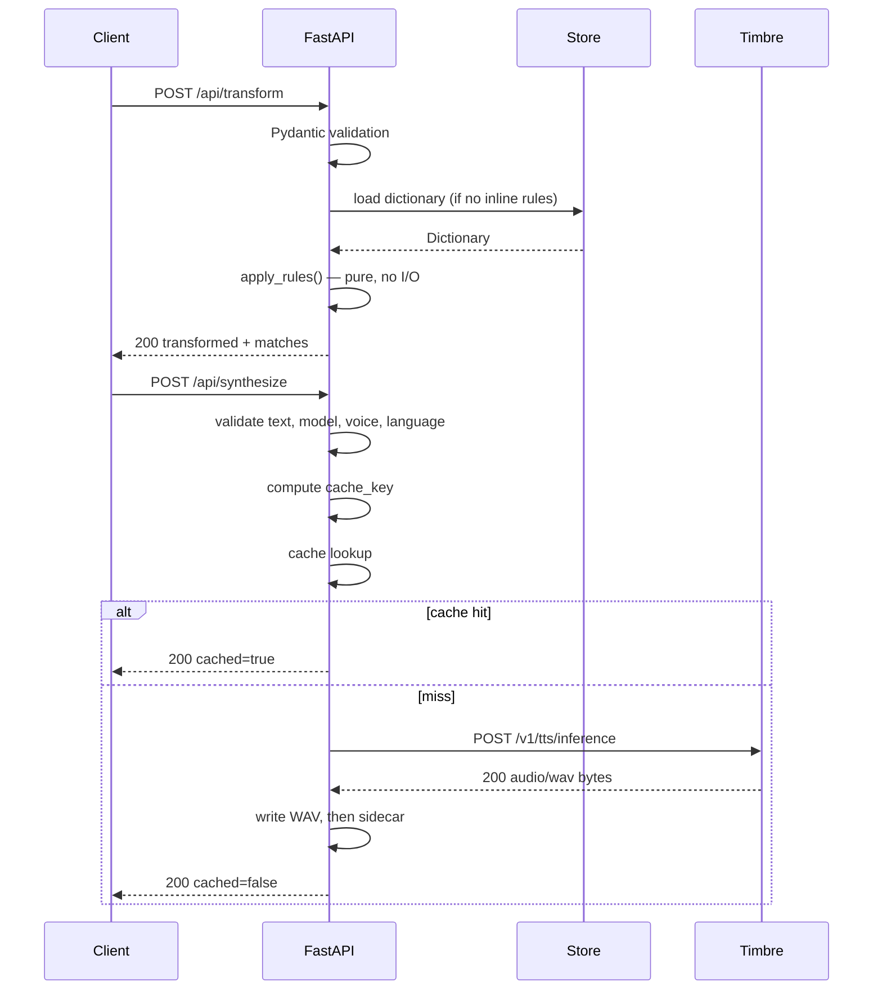

# Timbre Pronunciation Studio — Backend Schema

| Field | Value |
|---|---|
| Document | Backend Schema |
| Version | 1.0 |
| Date | 20 October 2026 |
| Status | Approved — binding, amended 22 October 2026 |
| Parent documents | `docs/PRD.md` v1.0, `docs/TRD.md` v1.0, `docs/App Flow.md` v1.0, `docs/UI-UX Brief.md` v1.0 |
| Owners | [You] — implements the models and store; [Teammate] — consumes the wire contract |
| Scope | On-disk formats, wire schemas, validation rules, error taxonomy |
| Format version | `schema_version: 1` |

---

## 1. Purpose

This document is the **contract**. It defines exactly:

1. What is written to disk (dictionaries, audio provenance).
2. What crosses the HTTP boundary (requests, responses, errors).
3. What is rejected, with which status code and which message.

The frontend and backend are built by two people. Ambiguity here produces integration defects that look like logic bugs. Every field below is therefore specified with a type, a constraint and a failure mode.

**Rule of precedence:** if this document conflicts with the TRD, this document wins for field-level detail and the TRD is corrected. Product behaviour still defers to the PRD.

---

## 2. Conventions

| Convention | Decision |
|---|---|
| Encoding | UTF-8, no BOM |
| JSON style | 2-space indent, no trailing commas, keys in the order shown |
| Timestamps | ISO 8601 UTC, second precision, `Z` suffix — `2026-10-20T11:12:04Z` |
| Identifiers | UUIDv4 with a type prefix — `dict_<uuid>`, `rule_<uuid>` |
| Booleans | `true` / `false`, never `1` / `0` |
| Nulls | Omitted rather than sent as `null`, except where explicitly stated |
| Field naming | `snake_case` on the wire and on disk |
| Numbers | `speed` is a JSON number, never a string |
| Binary | Only `/api/audio/{cache_key}` returns non-JSON |

---

## 3. Storage layout

```text
data/
  dictionaries/
    dict_3f2a9c1e-....json      # one file per dictionary
    dict_7b04d812-....json
  audio/
    a3f9c2...e1.wav             # 64 hex chars + .wav
    a3f9c2...e1.json            # provenance sidecar, same stem
```

### 3.1 Discovery

**No index file.** The store enumerates `data/dictionaries/*.json`, parses each, and builds the in-memory view. Consequences:

| Property | Behaviour |
|---|---|
| Adding a file externally | Appears on next read |
| Removing a file externally | Disappears on next read |
| Index desync | Impossible by construction |
| Startup cost | One read per dictionary; negligible below hundreds |

### 3.2 Directory creation

Both directories are created with `mkdir(parents=True, exist_ok=True)` at startup. A missing `data/` is not an error.

### 3.3 File naming

The filename is `{dictionary.id}.json`. The ID is the filename, so renaming a dictionary never renames a file. Filenames are never derived from the user-supplied name — that would invite path traversal and duplicate-on-case-insensitive-filesystem bugs.

### 3.4 Ignored files

Files that do not match `^dict_[0-9a-f-]{36}\.json$` are ignored silently. This allows `README.md` or `.gitkeep` in the directory without error.

---

## 4. Dictionary file schema

### 4.1 Example

```json
{
  "schema_version": 1,
  "id": "dict_3f2a9c1e-5b7d-4a91-9c02-1e8f4d6b2a10",
  "name": "Gnani Demo",
  "created_at": "2026-10-20T11:12:04Z",
  "updated_at": "2026-10-20T11:31:47Z",
  "rules": [
    {
      "id": "rule_8b1d4c02-9e3f-4a55-b7c1-0d2e6f8a1b34",
      "source": "Timbre",
      "replacement": "Tamber",
      "type": "alias",
      "created_at": "2026-10-20T11:12:04Z",
      "updated_at": "2026-10-20T11:12:04Z"
    },
    {
      "id": "rule_2c7f9a11-4d8b-4e06-8a3d-5b1c9e0f7d22",
      "source": "Bengaluru",
      "replacement": "Bengalooru",
      "type": "alias",
      "created_at": "2026-10-20T11:14:22Z",
      "updated_at": "2026-10-20T11:14:22Z"
    }
  ]
}
```

### 4.2 Dictionary fields

| Field | Type | Required | Constraint | Notes |
|---|---|---|---|---|
| `schema_version` | integer | Yes | Must equal `1` | Rejected if higher; see §10 |
| `id` | string | Yes | `^dict_[0-9a-f]{8}-[0-9a-f]{4}-4[0-9a-f]{3}-[89ab][0-9a-f]{3}-[0-9a-f]{12}$` | Immutable; matches filename |
| `name` | string | Yes | 1–80 characters after trim; unique case-insensitively | Display name |
| `created_at` | string | Yes | ISO 8601 UTC | Set once at creation |
| `updated_at` | string | Yes | ISO 8601 UTC, ≥ `created_at` | Set on every mutation |
| `rules` | array | Yes | May be empty; max 200 entries | Insertion order preserved |

### 4.3 Rule fields

| Field | Type | Required | Constraint | Notes |
|---|---|---|---|---|
| `id` | string | Yes | `^rule_[0-9a-f]{8}-[0-9a-f]{4}-4[0-9a-f]{3}-[89ab][0-9a-f]{3}-[0-9a-f]{12}$` | Immutable |
| `source` | string | Yes | 1–120 characters after trim; unique case-insensitively within the dictionary | Term as written |
| `replacement` | string | Yes | 1–200 characters after trim | Pronunciation-friendly text; casing preserved |
| `type` | string | Yes | Enum: `alias` only in v1 | `phoneme` rejected; see §7.6 |
| `created_at` | string | Yes | ISO 8601 UTC | Used as the deterministic tie-breaker in matching |
| `updated_at` | string | Yes | ISO 8601 UTC, ≥ `created_at` | Set on edit |

### 4.4 Deliberate omissions

| Not stored | Why |
|---|---|
| Match counts | Derived per transform; storing them would go stale |
| Script text | Scripts live in the UI's session state; the backend is stateless about them |
| Model/voice per dictionary | Settings are per-session, not per-dictionary; stored in the export envelope instead |
| Soft-delete flag | Deletion is hard (§6.3) |
| Description | Not in v1; adds a UI field with no demonstrated need |

### 4.5 Invariants

Enforced on every write and asserted in tests:

1. `id` matches the filename stem.
2. `schema_version == 1`.
3. `updated_at >= created_at` for the dictionary and every rule.
4. `name` is unique case-insensitively across the whole store.
5. `source` is unique case-insensitively within `rules`.
6. Every `rule.type == "alias"`.
7. `rules` is an array, order preserved as written.
8. No duplicate rule `id` within a dictionary.
9. All strings are already trimmed.

---

## 5. Atomic write procedure

Every mutation is a full-file rewrite. Partial writes must be impossible.

```text
1. Acquire the store lock (threading.Lock, process-wide).
2. Validate the in-memory object against §4.5.
3. Serialise to UTF-8 JSON with 2-space indent.
4. Write to data/dictionaries/.{id}.json.tmp in the same directory.
5. os.replace(tmp_path, final_path)   # atomic on Windows and POSIX
6. Release the lock.
```

**Why `os.replace` and not `os.rename`:** `os.replace` overwrites an existing target atomically on Windows; `os.rename` raises if the target exists. Both are same-volume operations because the temp file is created beside the target.

**Why the lock:** FastAPI may serve concurrent requests. Two simultaneous writes to the same file with only atomic replace would still lose one update.

**Failure handling:** if step 4 or 5 fails, the temp file is removed in a `finally` block and the API returns `500 INTERNAL_ERROR`. The previous file is untouched.

---

## 6. Store operations

### 6.1 Read all

```text
for path in sorted(glob("data/dictionaries/dict_*.json")):
    try: parse and validate
    except: log to console, skip file, append to store_warnings
return dictionaries, store_warnings
```

A corrupt file **never** prevents the app from starting. It is skipped, logged, and reported once in the dictionaries list response as `warnings[]`. Silently ignoring it would hide data loss from the user.

### 6.2 Create

```json
{ "name": "My Brand" }
```

- Trim, validate length, check uniqueness case-insensitively.
- Generate `id` and `created_at`; set `updated_at = created_at`.
- `rules` starts as `[]`.
- Write atomically. Return the full dictionary.

### 6.3 Delete

- Confirmed in the UI (`UI-UX Brief` §8.11).
- `os.remove(path)`. File gone; no archive, no tombstone.
- Audio cache entries are **not** deleted: they are content-addressed and may be referenced by another dictionary.
- Returns `204 No Content`.

### 6.4 Rename

- Changes `name` and `updated_at` only.
- The file is rewritten; the filename does not change.
- Collision on the new name returns `409`.

---

## 7. Wire schemas

Base path: `/api`. All request and response bodies are JSON except §7.8.

### 7.1 `GET /api/health`

```json
{
  "status": "ok",
  "key_configured": true,
  "version": "1.0.0",
  "models_available": ["timbre-v3.0", "timbre-v2.5"]
}
```

| Field | Type | Notes |
|---|---|---|
| `status` | string | Always `"ok"` when the process is serving |
| `key_configured` | boolean | **Never** the key, its prefix, or its length |
| `version` | string | App version from `config.py` |
| `models_available` | array | Models the client may offer; trimmed if a smoke test proves one is unavailable |

### 7.2 `GET /api/options`

Served from a static catalogue in `backend/app/catalogue.py`, not from an upstream call.

```json
{
  "models": [
    {
      "id": "timbre-v3.0",
      "label": "Timbre v3.0",
      "default_voice": "Lakshmi",
      "voices": [
        { "id": "Lakshmi",  "gender": "female", "persona": "Expressive, energetic" },
        { "id": "Shivani",  "gender": "female", "persona": "Warm, empathetic" },
        { "id": "Avinash",  "gender": "male",   "persona": "Professional" }
      ]
    },
    {
      "id": "timbre-v2.5",
      "label": "Timbre v2.5",
      "default_voice": "Kaveri",
      "voices": [
        { "id": "Kaveri", "gender": "female", "persona": "Professional" },
        { "id": "Pranav", "gender": "male",   "persona": "Friendly" }
      ]
    }
  ],
  "language": "en-IN",
  "speed": 1.0,
  "limits": { "warn_at": 800, "block_at": 2000 },
  "audio_config": {
    "sample_rate": 48000,
    "num_channels": 1,
    "sample_width": 2,
    "encoding": "linear_pcm",
    "container": "wav"
  }
}
```

**Full voice catalogue, English only (`en-IN`), as of 20 Oct 2026:**

| Model | Voices |
|---|---|
| `timbre-v3.0` | Lakshmi, Shivani, Kalpana, Chetana, Vasudha, Riyaa, Tarika (female); Avinash, Shubham, Prakash, Devansh, Yashraj, Harshad (male) |
| `timbre-v2.5` | Kaveri, Trupti, Devika (female); Pranav, Shlok, Girish (male) |

v3.0 voices speak all 10 languages, but only `en-IN` is offered in v1. v2.5 voices are language-locked, so only its English set is listed.

### 7.3 `GET /api/dictionaries`

```json
{
  "dictionaries": [
    {
      "id": "dict_3f2a9c1e-5b7d-4a91-9c02-1e8f4d6b2a10",
      "name": "Gnani Demo",
      "rule_count": 3,
      "created_at": "2026-10-20T11:12:04Z",
      "updated_at": "2026-10-20T11:31:47Z"
    }
  ],
  "warnings": []
}
```

`rules` is omitted from the list response; the client fetches rules per dictionary. `warnings` is present only when a file was skipped (§6.1), and reads:

```json
{ "warnings": [ { "file": "dict_7b04d812-....json", "reason": "invalid JSON" } ] }
```

### 7.4 `POST /api/dictionaries`

Request:

```json
{ "name": "My Brand" }
```

Response `201` — the full dictionary object from §4.1 with `rules: []`.

### 7.5 `PATCH /api/dictionaries/{dictionary_id}`

Request:

```json
{ "name": "My Brand v2" }
```

Response `200` — the full dictionary object.

### 7.6 `DELETE /api/dictionaries/{dictionary_id}`

Response `204`, empty body.

### 7.7 Rules

| Method | Path | Request | Success |
|---|---|---|---|
| `GET` | `/api/dictionaries/{id}/rules` | — | `200` `{ "rules": [ ... ] }` |
| `POST` | `/api/dictionaries/{id}/rules` | `{ "source": "...", "replacement": "...", "type": "alias" }` | `201` rule object |
| `PATCH` | `/api/rules/{rule_id}` | any subset of `source`, `replacement`, `type` | `200` rule object |
| `DELETE` | `/api/rules/{rule_id}` | — | `204` |

`type` defaults to `"alias"` when omitted. Any other value is rejected:

```json
{
  "success": false,
  "error": {
    "type": "VALIDATION_ERROR",
    "message": "Rule type 'phoneme' is not supported. Only 'alias' rules are available in this release.",
    "details": [{ "field": "type", "issue": "unsupported_value" }]
  }
}
```

### 7.8 `GET /api/audio/{cache_key}`

- Binary `audio/wav`.
- Headers: `Content-Type: audio/wav`, `Content-Length`, `Accept-Ranges: bytes`, `Cache-Control: private, max-age=3600`.
- The path may carry the `.wav` suffix that `audio_url` uses; the implementation strips it and then validates the key itself against `^[a-f0-9]{64}$` before any filesystem access. A non-match returns `404` (not `400`, to avoid confirming path shape).
- Missing file returns `404` with the standard JSON error envelope.

---

## 8. Transform and synthesis

### 8.1 `POST /api/transform`

Request:

```json
{
  "text": "Timbre speaks Indian languages clearly.",
  "dictionary_id": "dict_3f2a9c1e-5b7d-4a91-9c02-1e8f4d6b2a10",
  "rules": null
}
```

| Field | Type | Required | Notes |
|---|---|---|---|
| `text` | string | Yes | May be empty (returns an empty result rather than an error) |
| `dictionary_id` | string \| null | One of the two | Ignored when `rules` is supplied |
| `rules` | array \| null | One of the two | Inline rules for unsaved preview; each item needs `source` and `replacement`; `id` is optional |

**Precedence:** if `rules` is a non-null array, it is used and `dictionary_id` is not consulted. This supports live preview of unsaved edits (`App Flow` §7).

Response `200`:

```json
{
  "original_text": "Timbre speaks Indian languages clearly.",
  "transformed_text": "Tamber speaks Indian languages clearly.",
  "changed": true,
  "char_count": 38,
  "limit": { "warn_at": 800, "block_at": 2000, "status": "ok" },
  "matches": [
    { "rule_id": "rule_8b1d...", "source": "Timbre", "replacement": "Tamber", "count": 1 },
    { "rule_id": "rule_2c7f...", "source": "Bengaluru", "replacement": "Bengalooru", "count": 0 }
  ],
  "warnings": [
    { "code": "RULE_NOT_FOUND_IN_TEXT", "rule_id": "rule_2c7f...", "message": "Term not found in this script." }
  ]
}
```

| Field | Notes |
|---|---|
| `changed` | `false` when `transformed_text == original_text` |
| `char_count` | Length of `original_text` in Unicode code points |
| `limit.status` | `ok` \| `warn` \| `block` |
| `matches` | One entry per rule, **including zero counts**, in the order rules were applied |
| `warnings` | `RULE_NOT_FOUND_IN_TEXT`, `REPLACEMENT_CONTAINS_MARKUP`, `RULE_CHAIN_DETECTED` |

`limit.status == "block"` returns `400 LIMIT_EXCEEDED` instead of `200`. The transform endpoint performs **no** upstream call and spends no credits.

### 8.2 `POST /api/synthesize`

Request:

```json
{
  "text": "Tamber speaks Indian languages clearly.",
  "model": "timbre-v3.0",
  "voice": "Lakshmi",
  "language": "en-IN",
  "speed": 1.0
}
```

| Field | Type | Required | Constraint |
|---|---|---|---|
| `text` | string | Yes | 1–2,000 characters after trim |
| `model` | string | Yes | Enum: `timbre-v3.0`, `timbre-v2.5` |
| `voice` | string | Yes | Must belong to the selected model's catalogue (§7.2) |
| `language` | string | No | Fixed to `en-IN`; any other value is rejected |
| `speed` | number | No | 0.85–1.15; defaults to `1.0` |

Response `200`:

```json
{
  "cache_key": "a3f9c2e1b47d0586f2c9a1e3d5b7c0f4a2e6d8b1c3f5a7e9d0b2c4f6a8e1d3b5",
  "audio_url": "/api/audio/a3f9c2e1b47d0586f2c9a1e3d5b7c0f4a2e6d8b1c3f5a7e9d0b2c4f6a8e1d3b5.wav",
  "cached": false,
  "bytes": 184320,
  "settings": {
    "model": "timbre-v3.0",
    "voice": "Lakshmi",
    "language": "en-IN",
    "speed": 1.0,
    "sample_rate": 48000,
    "num_channels": 1,
    "sample_width": 2,
    "container": "wav"
  }
}
```

| Field | Notes |
|---|---|
| `cache_key` | 64 lowercase hex characters; see §9.1 |
| `audio_url` | Absolute path, **includes** the `.wav` extension |
| `cached` | `true` on a cache hit; no credits spent |
| `settings` | Echoed so the client can prove a comparison pair used identical settings |

---

## 9. Audio cache schema

### 9.1 Cache key

```text
cache_key = sha256(
    text + "\x1f" + model + "\x1f" + voice + "\x1f" + language + "\x1f" +
    str(speed) + "\x1f" + canonical_audio_config_json
).hexdigest()
```

`\x1f` (unit separator) cannot appear in any input, so concatenation is unambiguous. `canonical_audio_config_json` is `json.dumps(cfg, sort_keys=True, separators=(",", ":"))`.

**All six inputs are included.** Omitting any one would let a voice change return the previous voice's audio — the single most damaging bug possible in a before/after comparison. A unit test asserts that changing each input changes the key.

### 9.2 Sidecar file

`data/audio/{cache_key}.json`:

```json
{
  "schema_version": 1,
  "cache_key": "a3f9c2e1b47d0586f2c9a1e3d5b7c0f4a2e6d8b1c3f5a7e9d0b2c4f6a8e1d3b5",
  "generated_at": "2026-10-20T11:40:12Z",
  "text": "Tamber speaks Indian languages clearly.",
  "text_sha256": "9f2c...",
  "char_count": 38,
  "settings": {
    "model": "timbre-v3.0",
    "voice": "Lakshmi",
    "language": "en-IN",
    "speed": 1.0,
    "sample_rate": 48000,
    "num_channels": 1,
    "sample_width": 2,
    "container": "wav"
  },
  "audio": {
    "file": "a3f9c2e1....wav",
    "bytes": 184320,
    "duration_seconds": 1.92
  },
  "upstream": {
    "status": 200,
    "elapsed_ms": 1840
  }
}
```

| Field | Purpose |
|---|---|
| `text` | Provenance: which text produced this audio |
| `text_sha256` | Cheap integrity check without comparing full strings |
| `settings` | Proof of the settings used, including the audio config |
| `upstream` | Latency and status for the latency NFR and for debugging |

**Duration note (verified 20 October 2026):** Timbre returns WAVs whose RIFF and `data` chunk sizes are `0xFFFFFFFF` streaming placeholders. `wave` then reports 2,147,483,647 frames — about 44,739 seconds for every file. `duration_seconds` is therefore computed from the actual PCM payload length, never from the declared frame count.

### 9.3 Privacy boundary

The sidecar contains script text. This is deliberate and bounded:

- `data/audio/` is gitignored.
- The sidecar is a **user artefact**, not a log. TRD §9.4's rule against logging text applies to log output, not to this file.
- The README states that generated audio and its sidecars are local only and may contain the user's text.
- No endpoint serves the sidecar. It is inspectable on disk only.

### 9.4 Sidecar failure

If the WAV is written but the sidecar fails, the audio is still served. A missing sidecar is not an error; it only loses provenance. The write order is **WAV first, sidecar second**, so a crash never leaves a sidecar pointing at a missing file.

---

## 10. Versioning and migration

### 10.1 Load policy

| Condition | Behaviour |
|---|---|
| `schema_version == 1` | Load normally |
| `schema_version > 1` | Reject the file; skip it; add a `warnings[]` entry: `"created by a newer version"` |
| `schema_version` missing | Reject as invalid |
| `schema_version < 1` | Reject as invalid |

Rejecting rather than guessing protects the user's data from a lossy downgrade.

### 10.2 Write policy

- Always write `schema_version: 1`.
- Unknown top-level fields are **dropped** on rewrite. This is an accepted risk of a v1 format: there is no downgrade path and no other writer exists. Documented rather than silently tolerated.
- Unknown fields inside a rule are likewise dropped.

### 10.3 Future changes

A format change requires:

1. Bumping to `schema_version: 2`.
2. Writing a migration that reads v1 and writes v2.
3. Keeping the v1 reader for one release.

No migration code exists in v1. This section exists so the decision is not improvised later.

---

## 11. Error taxonomy

### 11.1 Envelope

Every non-2xx JSON response uses:

```json
{
  "success": false,
  "error": {
    "type": "VALIDATION_ERROR",
    "message": "Replacement cannot be empty.",
    "details": [{ "field": "replacement", "issue": "empty" }]
  }
}
```

| Field | Type | Notes |
|---|---|---|
| `success` | boolean | Always `false`; present for symmetry with Gnani's upstream shape |
| `error.type` | string | From the enum in §11.2 |
| `error.message` | string | Human-readable, sentence case, ends with a period |
| `error.details` | array | Optional; field-level entries only |

### 11.2 Types and status codes

| `type` | HTTP | When |
|---|---|---|
| `VALIDATION_ERROR` | 400 | Malformed value, empty required field, unsupported enum |
| `LIMIT_EXCEEDED` | 400 | Script over `block_at`, or over 200 rules |
| `NOT_FOUND` | 404 | Unknown dictionary, rule, or cache key |
| `CONFLICT` | 409 | Duplicate dictionary name |
| `UPSTREAM_AUTH` | 401 | Gnani returned 401 |
| `UPSTREAM_FORBIDDEN` | 403 | Gnani returned 403 |
| `UPSTREAM_RATE_LIMIT` | 429 | Gnani returned 429 |
| `UPSTREAM_BAD_REQUEST` | 400 | Gnani returned 400 |
| `UPSTREAM_ERROR` | 502 | Gnani returned 500 or 503 |
| `UPSTREAM_TIMEOUT` | 504 | `requests.Timeout` |
| `UPSTREAM_UNREACHABLE` | 503 | `requests.ConnectionError` |
| `CONFIGURATION_ERROR` | 500 | Key missing or invalid configuration at runtime |
| `INTERNAL_ERROR` | 500 | Unhandled exception, or a failed disk write |

### 11.3 Canonical messages

These strings are contract, not suggestions. The frontend may wrap them but must not invent alternatives.

**Two stages, two status codes.** Schema-level rejections — an empty string, an
over-length field, an unexpected key — are caught by Pydantic before any domain
code runs. They return `422` with `type: VALIDATION_ERROR`, the generic message
`The request body is invalid.`, and a `details[]` entry naming the field and the
Pydantic issue code (for example `string_too_short`). The canonical messages
below apply once a value reaches domain validation, for example a whitespace-only
name, which is non-empty to the schema but empty after trimming. A `422` and a
`400` therefore share the same envelope and the frontend renders `error.message`
in both cases; only the message differs.

| Condition | `type` | `message` |
|---|---|---|
| Empty name | `VALIDATION_ERROR` | `Dictionary name cannot be empty.` |
| Name too long | `VALIDATION_ERROR` | `Dictionary name must be 80 characters or fewer.` |
| Duplicate name | `CONFLICT` | `A dictionary named "My Brand" already exists.` |
| Empty source | `VALIDATION_ERROR` | `Source term cannot be empty.` |
| Source too long | `VALIDATION_ERROR` | `Source term must be 120 characters or fewer.` |
| Empty replacement | `VALIDATION_ERROR` | `Replacement cannot be empty.` |
| Replacement too long | `VALIDATION_ERROR` | `Replacement must be 200 characters or fewer.` |
| Duplicate source | `VALIDATION_ERROR` | `This dictionary already has a rule for "Timbre".` |
| Unsupported type | `VALIDATION_ERROR` | `Rule type 'phoneme' is not supported. Only 'alias' rules are available in this release.` |
| Over limit | `LIMIT_EXCEEDED` | `Script is 2,140 characters. The limit is 2,000.` |
| Too many rules | `LIMIT_EXCEEDED` | `This dictionary has 200 rules, the maximum for this release.` |
| Unknown dictionary | `NOT_FOUND` | `Dictionary not found.` |
| Unknown rule | `NOT_FOUND` | `Rule not found.` |
| Unknown audio | `NOT_FOUND` | `Audio not found.` |
| Voice/model mismatch | `VALIDATION_ERROR` | `Voice "Nalini" is not available for model "timbre-v3.0".` |
| Unsupported language | `VALIDATION_ERROR` | `Only English (en-IN) is supported in this release.` |
| Missing key | `CONFIGURATION_ERROR` | `GNANI_API_KEY is not set. Add it to backend/.env and restart.` |
| Upstream auth | `UPSTREAM_AUTH` | `Timbre rejected the API key. Check the key in backend/.env.` |
| Upstream forbidden | `UPSTREAM_FORBIDDEN` | `Timbre refused the request. Check permissions and remaining credits.` |
| Upstream rate limit | `UPSTREAM_RATE_LIMIT` | `Too many requests. Wait a moment, then try again.` |
| Upstream error | `UPSTREAM_ERROR` | `Timbre is temporarily unavailable. Try again shortly.` |
| Timeout | `UPSTREAM_TIMEOUT` | `The request timed out. Shorten the script or try again.` |
| Unreachable | `UPSTREAM_UNREACHABLE` | `Cannot reach the Timbre API. Check your connection.` |
| Disk write failure | `INTERNAL_ERROR` | `Could not save the dictionary. Check that the data folder is writable.` |

### 11.4 Upstream detail passthrough

When Gnani returns a structured error, the upstream reason is appended to `details` so the user sees the real cause without exposing headers:

```json
{
  "success": false,
  "error": {
    "type": "UPSTREAM_BAD_REQUEST",
    "message": "Invalid request: Value error, Voice 'Nalini' is not supported by model 'timbre-v3.0'.",
    "details": [
      { "field": "upstream", "issue": "HTTP_400",
        "message": "Invalid request: Value error, Voice 'Nalini' is not supported by model 'timbre-v3.0'." }
    ]
  }
}
```

**Two upstream shapes must be accepted.** A live probe on 20 October 2026 returned a flat body with no `error` object:

```json
{ "success": false, "status_code": 400,
  "message": "Invalid request: Value error, Voice 'NoSuchVoice' is not supported by model 'timbre-v3.0'. Supported voices: ..." }
```

`gnani_tts._read_error_body` therefore reads `error.{type,message}` when present and otherwise falls back to top-level `status_code` (as `HTTP_<code>`) and `message`. When neither shape yields a message, the client uses the canonical message for the status code.

---

## 12. Pydantic model map

| Wire object | Model | Module |
|---|---|---|
| `{ name }` | `DictionaryCreate` | `models/schemas.py` |
| `{ name }` | `DictionaryUpdate` | `models/schemas.py` |
| Dictionary file | `Dictionary` | `models/schemas.py` |
| `{ source, replacement, type }` | `RuleCreate` | `models/schemas.py` |
| Partial rule | `RuleUpdate` | `models/schemas.py` |
| Rule object | `Rule` | `models/schemas.py` |
| Transform request | `TransformRequest` | `models/schemas.py` |
| Transform response | `TransformResponse` | `models/schemas.py` |
| Synthesis request | `SynthesizeRequest` | `models/schemas.py` |
| Synthesis response | `SynthesizeResponse` | `models/schemas.py` |
| Error envelope | `ErrorResponse` | `models/schemas.py` |
| Health | `HealthResponse` | `models/schemas.py` |
| Options | `OptionsResponse` | `models/schemas.py` |

**Conventions:** all models use `model_config = ConfigDict(extra="forbid")` so an unexpected field is a `422` rather than a silent no-op. Field constraints are declared with `Field(min_length=..., max_length=...)`, not hand-checked, so FastAPI generates accurate OpenAPI at `/docs`.

**One deliberate exception:** `TransformRequest.rules` uses `extra="ignore"`, because the client sends rule objects that may carry `id` and `updated_at` from the table state.

---

## 13. Request lifecycle



No endpoint writes to the store during a transform. No endpoint calls Timbre during a transform. Synthesis never mutates a dictionary.

---

## 14. Test fixtures

Required fixtures in `backend/tests/fixtures/`:

| Fixture | Purpose |
|---|---|
| `dict_aaaaaaaa-1111-4111-8111-111111111111.json` | "Minimal": one dictionary, zero rules |
| `dict_bbbbbbbb-2222-4222-9222-222222222222.json` | "Gnani Demo": the three-rule seed dictionary |
| `dict_cccccccc-3333-4333-a333-333333333333.json` | "Duplicate Source": two rules whose sources differ only in case — must fail validation and be skipped |
| `dict_dddddddd-4444-4444-b444-444444444444.json` | "From The Future": `schema_version: 2` — must be skipped with a warning |
| `dict_eeeeeeee-5555-4555-8555-555555555555.json` | "Truncated": invalid JSON — must be skipped with a warning |
| `dict_ffffffff-6666-4666-a666-666666666666.json` | "Devanagari": Devanagari source, Latin replacement |
| `export_valid.json` | A valid export envelope for import tests (stretch) |

Fixture filenames are dictionary ids, not descriptions: the store ignores any
file not matching `^dict_[0-9a-f-]{36}\.json$` (§3.4), so a descriptive name
would be skipped silently and test nothing. Fixtures are committed; `data/` is
not.

---

## 15. Traceability

| TRD section | Covered by |
|---|---|
| §7 HTTP contract | §7, §8, §11 |
| §8 Rule engine data model | §4.3 |
| §10 Persistence | §3, §4, §5, §6 |
| §11 Audio cache | §9 |
| §9.4 Logging discipline | §9.3 (sidecar boundary) |
| §17 Security | §3.3 (filename derivation), §7.8 (path validation) |

| PRD requirement | Covered by |
|---|---|
| FR-05 length limits | §7.2 `limits`, §8.1 `limit`, §11.3 |
| FR-06 markup warning | §8.1 `warnings[].code = REPLACEMENT_CONTAINS_MARKUP` |
| FR-10 JSON persistence | §3, §4 |
| FR-11 duplicate rejection | §4.5 invariant 5, §11.3 |
| FR-12 reserved rule type | §4.3, §7.7 |
| FR-13 export | §16 |
| FR-21 settings echo | §8.2 `settings` |
| FR-26 error surfacing | §11 |
| FR-30 key never exposed | §7.1 `key_configured` |

---

## 16. Export envelope (stretch, FR-13)

```json
{
  "schema_version": 1,
  "exported_at": "2026-11-02T09:15:00Z",
  "exported_by": "timbre-pronunciation-studio/1.0",
  "dictionary": {
    "schema_version": 1,
    "id": "dict_3f2a9c1e-...",
    "name": "Gnani Demo",
    "created_at": "2026-10-20T11:12:04Z",
    "updated_at": "2026-10-20T11:31:47Z",
    "rules": [ "...as stored..." ]
  },
  "baseline": {
    "model": "timbre-v3.0",
    "voice": "Lakshmi",
    "language": "en-IN",
    "speed": 1.0,
    "audio_config": { "sample_rate": 48000, "num_channels": 1, "sample_width": 2, "encoding": "linear_pcm", "container": "wav" }
  }
}
```

`baseline` records the settings the dictionary was tested with, so the export is self-describing rather than a bare list of strings. Import (FR-14) validates `schema_version`, regenerates IDs on collision, and reports skipped rules rather than failing the whole import.

---

## 17. Open questions

| # | Question | Resolves by |
|---|---|---|
| B1 | Does the upstream 400 body always include `error.type` and `error.message`? | **Resolved 20 Oct 2026: no.** Observed `{success, status_code, message}` with no `error` object. Client accepts both shapes (§11.4). |
| B2 | Is a 200 response ever returned with an empty body? | **Observed 20 Oct 2026: no.** Every 200 carried audio (276,524 / 337,964 / 7,549,484 bytes). Empty-body handling remains as a guard. |
| B3 | What is the real upstream latency for 800 characters (for `upstream.elapsed_ms` baselines)? | **Measured 22 Oct 2026:** 5 scripts of 787–799 characters → 4,377–6,905 ms (median 6,157 ms), 4.4–4.8 MB each. Longer inputs: 1,330 characters → 7,153 ms / 7.5 MB (20 Oct); 1,897 characters → 10,970 ms / 11.2 MB; 2,000 characters → 9,197 ms / 12.0 MB (22 Oct). Short sentence → 875 ms. Size is predictable at ~6 KB per character (5,903 → 5,983 bytes/char across 1,897 → 2,000); **time is not** — the 2,000-character request was 1.8 s faster than the 1,897 one, so do not extrapolate per-character latency from these samples |
| B6 | What does the API do with a script above 2,000 characters? | **Measured 22 Oct 2026:** 2,000 characters → HTTP 200 in 9,197 ms, so the app's block (`SCRIPT_BLOCK_CHARS = 2000`) admits exactly one length the API accepts. 2,100 characters → failed in **133 ms**, surfaced as `UPSTREAM_ERROR` (502) with the canonical message and no parseable upstream detail. A fast failure, not a timeout — but it is indistinguishable from a genuine outage at the UI layer, which is why the app blocks locally and says so instead of forwarding the request. The upstream threshold lies in (2,000, 2,100]; 2,001–2,099 is untested and unreachable through the app |
| B4 | Do v3.0 voices reject `speed` outside 0.85–1.15 with 400, or clamp silently? | **Not tested, and not worth testing in v1.** Speed is fixed at `1.0` and range-validated before any call (FR-20), so the answer changes no shipped behaviour. Revisit only if speed becomes user-editable | — |
| B5 | Should `matches` order follow rule application order or table order? **Resolved: application order** — longest source first, then `created_at`, then id. The UI has not been built yet, so this is not yet confirmed against it. | M5 (decided); UI confirmation at M7c |

---

## 18. Approval

Approved when both builders confirm:

- [ ] The on-disk format in §4 is final; no field is added after freeze without a version bump.
- [ ] The error envelope and canonical messages in §11 are accepted as contract.
- [ ] The six-input cache key in §9.1 is accepted as mandatory.
- [ ] The sidecar privacy boundary in §9.3 is understood and accepted.
- [ ] `extra="forbid"` in §12 is accepted, with the one documented exception.
