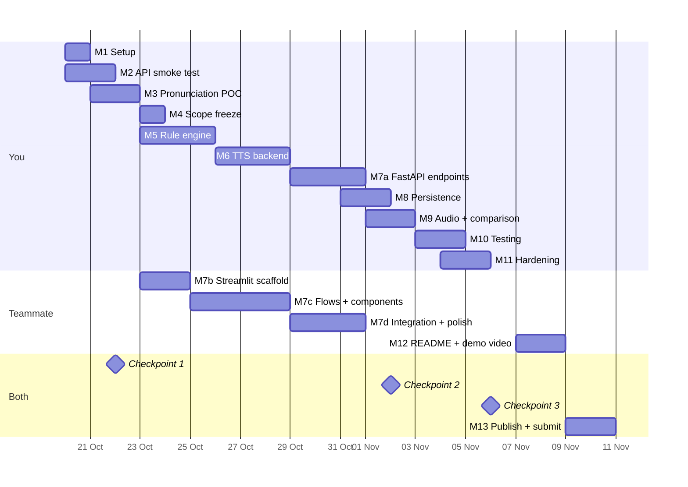

# Timbre Pronunciation Studio — Implementation Plan

| Field | Value |
|---|---|
| Document | Implementation Plan |
| Version | 1.0 |
| Date | 20 October 2026 |
| Status | Approved and in execution. Backend milestones M1–M3 and M5–M8 are done (147 backend tests green); the limit measurement (10.6) is done. The Streamlit UI (M7b–d) and the audio comparison (M9) are built, merged in PR #1 on 30 October 2026, and were run end to end with a real key before the merge. The pre-freeze audit fixes are done; 184 tests green. Remaining: M10–M13, including the demo video. Last check: 30 October 2026 |
| Parent documents | `docs/PRD.md`, `docs/TRD.md`, `docs/App Flow.md`, `docs/UI-UX Brief.md`, `docs/Backend Schema.md` (all v1.0) |
| Owners | [You] — backend, rule engine, POC, tests; [Teammate] — Streamlit UI, README, demo video |
| Build window | 20 October – 10 November 2026 |
| Feature freeze | **6 November 2026** |
| Submission deadline | **10 November 2026, 11:59 PM IST** |

---

## 1. Purpose

This document converts five specification documents into an executable schedule: numbered tasks, owners, effort estimates, completion criteria, checkpoints and pre-agreed scope cuts.

It exists to answer one question at any moment: **what do I do next, and how do I know it is finished?**

---

## 2. Working assumptions

| # | Assumption | If wrong |
|---|---|---|
| 1 | Each person has 10–15 hours per week | Cut order (§9) triggers earlier |
| 2 | Development happens on Windows with Python 3.10+ (no Node, no npm) | Verify in M1 before any other work |
| 3 | The 5,000 credits are on the primary registrant's account | Smoke test runs from that account |
| 4 | Both people can run the app locally | Teammate builds `streamlit_app/` against a scratch `DATA_DIR` with a **placeholder** `GNANI_API_KEY` (the process needs a non-empty value to start; generation needs a real one, see `TRD` §6.3) |
| 5 | The teammate's UI hours concentrate in 23–31 Oct | Compress M7; cut order applies |
| 6 | A private Git remote exists, with the teammate added as a collaborator (Write) | See §2.1 — without it there is no handover mechanism, only a folder copy |

### 2.1 Collaboration over a private remote

UI work happens on a **branch of the same private repository** and reaches `main`
through a pull request. There is no folder handover and no second remote.

- **Ownership.** You own `backend/`, `docs/`, `scripts/` and the root files. Your
  teammate owns `streamlit_app/`, plus her one dependency line in
  `backend/requirements.txt` (7b.6) and the UI section of `README.md`. Neither
  edits the other's area without saying so first.
- **No HTTP for the UI.** `streamlit_app/` imports `backend/app/core/` directly
  (7b.2). The FastAPI layer under `backend/app/api/` is an optional surface for
  `/docs`; `docs/Backend Schema.md` describes it and is **not** the UI's contract.
  `docs/App Flow.md` is.
- **Placeholder key, not the real one.** `GNANI_API_KEY=placeholder-not-a-real-key`
  in her own `backend/.env` satisfies startup (`TRD` §6.3) while every generation
  call fails cleanly with `401` — itself the error state worth building against. A
  scratch `DATA_DIR` keeps real dictionaries untouched (7b.4).
- **Reading order for the UI owner:** `docs/App Flow.md` (behaviour) →
  `docs/UI-UX Brief.md` §11 and §16.1 (microcopy, and which sections are binding)
  → `docs/TRD.md` §16.2 (run command and the four-line `sys.path` bootstrap) →
  this file, §14 (tasks 7b–7d) → `docs/LIMITATIONS.md` (what may not be claimed).

**Her part is complete when she can tick all six before marking the PR ready:**

1. A fresh clone on her branch runs with the documented one command (7b.5) — no
   `cd`, no `PYTHONPATH`, and `streamlit` installed by the requirements file alone.
2. Every state in `App Flow` is reachable: empty, warn, block, error, cached.
3. No credit is spent without pressing Generate; typing and transform never call
   upstream.
4. An `AppError` shows its status and a plain-language cause, and does not
   auto-dismiss.
5. The limitation note is visible without scrolling to it.
6. The PR adds no secret and no file outside her area, and carries the
   `streamlit>=1.40` line.

Integration (M7d) is the first run against the real `data/` directory and a real
key; that run is yours, not hers.

---

## 3. Working agreements

### 3.1 Definition of Done

Every task is done only when all five hold:

| # | Criterion |
|---|---|
| 1 | It runs from a clean start (fresh terminal, no stale state) |
| 2 | `pytest` passes for any touched backend module |
| 3 | No secret appears in code, logs, output, or a committed file |
| 4 | It matches the contract in `Backend Schema.md` or `UI-UX Brief.md` — no silent divergence |
| 5 | The other owner has run it end to end once and seen it work |

A task that "should work" is not done.

### 3.2 Version control

- `git init` in the project root during M1; `main` is the default branch.
- First commit is yours, before anyone clones: the repository holds no `.env` and
  no `data/`.
- Private repository, teammate added as a collaborator with **Write** (not Admin).
  She pushes `feat/streamlit-ui` to the same repository and opens the PR from it;
  she does not fork.
- UI work reaches `main` only through that PR, **squashed** on merge, branch
  deleted afterwards. Nobody pushes to `main` directly once it exists.
- Open the PR as a **draft** after the scaffold (7b) so a wrong direction costs two
  hours instead of eight; mark it ready when §2.1's checklist passes.
- Commit at the end of each task group, with a message naming the milestone:
  `M7b: Streamlit scaffold`, `M7c: flows and components`, `M7d: UI integrated`.
- `.gitignore` written **before** the first commit: `.env`,
  `.streamlit/secrets.toml`, `data/`, `.venv/`, `node_modules/`, `dist/`,
  `__pycache__/`, `*.pyc`.
- Branch protection may not be available on a free private repository; the review
  rule is by agreement, not enforcement.
- Rationale: rollback capability near the freeze date, and a clean contribution
  history if the repo is published later for the submission.

### 3.3 Cadence

| When | What |
|---|---|
| Start of session | `git status`; read the current checkpoint in §8 |
| End of session | Commit; note what is half-finished |
| Checkpoint days | Written go/no-go in §8, plus any scope cut applied |

---

## 4. Schedule at a glance

### 4.1 Effort budget

| Milestone | Owner | Estimate |
|---|---|---|
| M1 Setup | You | 1 h |
| M2 API smoke test | You | 2 h |
| M3 Pronunciation POC | You | 4 h |
| M4 Scope freeze | Both | 1 h |
| M5 Rule engine | You | 4 h |
| M6 TTS backend | You | 3 h |
| M7a FastAPI endpoints | You | 4 h |
| M7b–d Streamlit UI | Teammate | 5–7 h |
| M8 Persistence | You | 2 h |
| M9 Audio comparison | Both | 3 h |
| M10 Testing | You | 4 h |
| M11 Hardening | Both | 3 h |
| M12 README + demo | Teammate | 5 h |
| M13 Publish + submit | Both | 3 h |

**You: ~31 h. Teammate: ~15 h.** The Streamlit decision (21 Oct) removed the
18–22 h React build, so the teammate now has real slack; that slack is for the
README, the demo video and the public post, not for extra features. The cut
order in §9 is still not optional.

---

## 5. Milestone 1 — Project setup

**Owner:** You. **Effort:** ~1 h. **Target:** 20 Oct.

| # | Task | DoD |
|---|---|---|
| 1.1 | Verify `python --version` ≥ 3.10, `py --version`, `git --version` | All print versions; note which launcher works |
| 1.2 | Create `backend/`, `streamlit_app/`, `scripts/`, `data/dictionaries/`, `data/audio/` | Directories exist |
| 1.3 | `git init`; write `.gitignore` before the first commit | `.env`, `data/`, `.venv/`, `node_modules/`, `dist/` all ignored |
| 1.4 | Create `.venv`, activate, `pip install fastapi uvicorn requests python-dotenv pytest httpx` | `pip list` shows them |
| 1.5 | Write `backend/requirements.txt` with pinned versions | `pip install -r` works in a fresh venv |
| 1.6 | Write `backend/.env.example` with all keys from `Backend Schema` §6 | Committed, no real values |
| 1.7 | Copy to `backend/.env` and paste the real key **yourself** | File exists, gitignored, never opened in a shared screen |
| 1.8 | Commit: `M1: project scaffold, env template, gitignore` | Clean `git status` |

**Milestone DoD:** the environment runs and no secret is in version control.

---

## 6. Milestone 2 — Prove Timbre access

**Owner:** You. **Effort:** ~2 h. **Target:** 20–21 Oct. **This is Gate A.**

| # | Task | DoD |
|---|---|---|
| 2.1 | Write `scripts/smoke_test.py`: loads `.env`, calls `POST /api/v1/tts/inference` with `timbre-v2.5` + `Kaveri` + `en-IN`, saves `data/audio/smoke_v25.wav` | A playable WAV exists |
| 2.2 | Run it; listen | Speech is intelligible English |
| 2.3 | Repeat with `timbre-v3.0` + `Lakshmi`, saving `smoke_v30.wav` | Either a WAV, or a recorded 400/403 |
| 2.4 | Record: status, byte size, elapsed ms, and whether v2.5 worked | Written into §8 Checkpoint 1 |
| 2.5 | Probe the error path: send an invalid voice; confirm the response body shape | Confirm whether `error.type` / `error.message` are present (resolves B1) |
| 2.6 | Probe an 800-character request; record latency | Resolves TQ4 |
| 2.7 | Check the dashboard credit balance before and after | Credit spend per call is known |
| 2.8 | Commit: `M2: smoke test, both models verified` | — |

**Milestone DoD:** one saved, playable WAV produced by your own code with your own key.

**If Gate A fails:** stop. Do not write any application code. Diagnose in this order — key copied fully, header name exact (`X-API-Key-ID`), credits present, model string exact, network reachable. Nothing else proceeds until a WAV exists.

---

## 7. Milestone 3 — Pronunciation POC

**Owner:** You. **Effort:** ~4 h. **Target:** 21–22 Oct. **This is Gate B, the project's viability test.**

| # | Task | DoD |
|---|---|---|
| 3.1 | Choose 8 terms across the six categories in `App Flow` Appendix A | Written list with intended pronunciation in plain words |
| 3.2 | Write one full sentence per term containing the term in natural context | 8 sentences, none of them the bare word |
| 3.3 | Author one candidate respelling per term: plain lowercase words, no angle brackets | 8 respellings |
| 3.4 | Write `scripts/poc_matrix.py`: for each term, generate original and adjusted with identical settings; save both WAVs with a naming convention | 16 WAVs, settings captured once |
| 3.5 | Run it; listen to every pair in order | All 16 files playable |
| 3.6 | Score each term: closer / no change / worse / damaged the sentence | 8 written verdicts with a reason |
| 3.7 | Inspect whether normalisation altered any respelling (compare intended vs heard) | Resolves TQ2 / PRD A2 |
| 3.8 | **SSML probe:** one request containing an SSML `<phoneme>` fragment; observe whether it is spoken, stripped, or rejected | **Done: rejected nothing, stripped everything.** HTTP 200; listening found no tag spoken, so SSML gives no phoneme control (TQ3 / PRD A5 closed) |
| 3.9 | Write the verdict: pass (≥6 of 8 improved, zero collateral damage) or fail | Written in §8 Checkpoint 1 |
| 3.10 | Commit: `M3: POC matrix, 8 terms, verdict recorded` | — |

**Scoring note (added 20 Oct).** Round 1 scored the audio against personal expectation of the term, while the respellings were builder-authored. That is not the gate question. The POC was re-run in two further steps: round 2 verified the mechanism (did the adjusted audio say the respelling as spelled — 7 yes, 1 partly, 0 no), and round 3 re-scores the gate question with **user-authored respellings** via `scripts/try_respelling.py`. Round 1 survives only as the session notes quoted in §8.1: no round-1 file was kept, and the only round-1 output on disk (`data/poc_results.json`) is a dry run that records nothing.

**Milestone DoD:** a written, evidenced pass/fail with all 16 audio files retained.

**If Gate B fails:** the 3-hour bounded retry (§10). Not open-ended iteration.

---

## 8. Checkpoints

### 8.1 Checkpoint 1 — 22 October: API proven and POC decided

| Check | Pass condition |
|---|---|
| Gate A | A WAV generated by your code |
| Gate B | ≥6 of 8 improved, zero collateral damage |
| Model access | Which of v2.5 / v3.0 work, recorded |
| Latency | 800-character round trip measured |
| SSML | Probe result recorded |

**Recorded 20 October 2026 — Gate A passed.**

| Check | Result |
|---|---|
| Gate A | Passed: WAVs produced by our own code with the registrant's key |
| Model access | Both `timbre-v2.5` / `Kaveri` and `timbre-v3.0` / `Lakshmi` returned HTTP 200 (276,524 and 337,964 bytes) |
| Error path | 400 body is `{success, status_code, message}` with no `error` object; client accepts both shapes |
| Latency | 1,330 characters → 7,153 ms, 7.5 MB WAV; short sentence → 875 ms |
| SSML | Probe accepted: HTTP 200, 245,804 bytes → `data/audio/ssml_probe.wav`. Heard on 22 October: the tag is **stripped** — nothing is spoken for it, so SSML provides no phoneme control. Task 3.8 and TQ3 are closed. |
| Gate B | **Passed 21 October 2026 — 8 of 8 closer, 0 damaged.** Threshold was ≥6 closer and zero collateral damage. Mechanism check (round 2): 7 of 8 adjusted files pronounced the word exactly as the applied respelling spelled it, 1 partly, 0 failures. Per-term evidence below. |

**Recorded 21 October 2026 — Gate B passed.**

| # | Term | Category | Respelling marked in the manifest | Verdict |
|---|---|---|---|---|
| 1 | Zentara | Invented brand | `Zen Taara` | closer |
| 2 | Timbre | Product name | `Tim-ber` | closer |
| 3 | Gnani | Product name | `Gyaa-nee` | closer |
| 4 | Shreyas | Indian personal name | `Shrey-ass` | closer |
| 5 | Iyer | Indian personal name | `I-yer` | closer |
| 6 | Coimbatore | Place name | `Koyamba-tore` | closer (partial) |
| 7 | SEBI | Acronym read as a word | `Say-bee` | closer |
| 8 | Kubernetes | Technical term | `Koo-ber-NET-eez` | closer |

**Score against §8.1:** 8 closer (threshold 6), 0 worse, 0 damaged → **pass**. Settings held constant: `timbre-v3.0`, `Lakshmi`, English, speed 1.0. Evidence: `docs/evidence/gate-b-try_results.json`, a committed copy of the per-term verdict plus every attempt (the live file is `data/try_results.json`, which is gitignored). The audio is local only: 20 WAVs in `data/audio/try/`, of which the manifest references 18, plus the rebuilt sheet `data/audio/try/listen.html`.

**Four caveats, recorded so the result is not overread:**

1. Two verdicts arrived as "yes" (Shreyas, Kubernetes) rather than one of the four labels. They are recorded as `closer` with the listener's own word kept in the manifest's `notes` field.
2. Coimbatore arrived as "partly". It is recorded as `closer` with that caveat and is **excluded from the seed dictionary** — a half-improved place name is not evidence for a demo.
3. One listener, one session, one model and voice, English only, 8 terms. This is a viability check, not a measured accuracy rate; no percentage is claimed anywhere.
4. The gate is closed. No further respelling rounds are run even though the score has margin, because §10 bounds experimentation and the remaining work is the UI.

**How the gate was reached.** The POC design had a defect, and the defect is understood rather than assumed. The respellings in `scripts/poc_matrix.py` were authored by the builder, and round 1 judged the audio against personal expectation of the term instead of against the respelling actually substituted. Those are different questions, and round 1 (1 closer, 2 no change, 1 worse, 4 damaged) is kept here as session notes — no round-1 artifact was retained, and it is not a gate result.

Round 2 asked the mechanism question: did the adjusted audio pronounce the word the way the respelling spells it? Answer: **7 yes, 1 partly, 0 no**, with zero collateral damage. The substitution path is sound — when a respelling is applied, the engine speaks that respelling. Round 1's damage verdicts were therefore a property of the builder-authored respellings, not of the mechanism.

Round 3 asked the gate's own question — is the result closer to the intended sound than the original? — with **user-authored respellings**, which is exactly what the product does. Answer: **8 of 8 closer, 0 damaged.** `scripts/try_respelling.py` drives that loop — it holds model, voice, language and speed constant, applies the substitution with the backend's real rule engine, reuses the round-1 originals where the sentence and settings are unchanged (four of eight cost no credits), rebuilds a listening sheet per term for the judgement, and records a verdict per term.

**Gate B passed, so:** M4 proceeds and task 4.1 adopts the winners as the seed dictionary; the teammate's M7b is unblocked for 23 October. The §10 failure protocol is not invoked and stays on record unused.

**Pre-agreed cut at this checkpoint:** if only one model works, drop the model selector (FR-17) to a fixed value and keep the voice selector.

### 8.2 Checkpoint 2 — 2 November: integration

| Check | Pass condition |
|---|---|
| Frontend integration | Load dictionaries → transform → synthesize → play audio, all through the in-process `core/` calls the UI imports (no HTTP layer) |
| Backend endpoints | All of `Backend Schema` §7 implemented |
| Rule engine | All PRD §8.3 tests pass |

**If integration passes:** continue to M9.
**If integration fails:** there is no second stack to fall back to. Apply cuts 5–6
(§9) and ship the smaller flow — dictionaries, transform, one comparison — rather
than an incomplete page. Streamlit is already the chosen UI.

**Pre-agreed cut at this checkpoint:** drop FR-13/FR-14 (export/import) regardless of integration status, to protect M10–M11.

### 8.3 Checkpoint 3 — 6 November: feature freeze

| Check | Pass condition |
|---|---|
| MVP acceptance | All seven criteria in `PRD` §11.2 |
| Secrets audit | No key in any file, log, or committed file |
| Restart test | Dictionaries survive a restart |
| Accessibility | Keyboard-only walkthrough completes |

**After this date, no new features.** Only defect fixes and documentation.

---

## 9. Scope cut order

Applied top-down. Never cut a must-have before cutting a stretch item.

Cuts 3 and 4 (dark mode, mobile rule cards) are **already in force** since the
Streamlit decision on 21 Oct (`UI-UX Brief` §16.1); they cost nothing further.
The list is kept in order so that a later cut never starts with a must-have.

| Order | Item | Requirement | Saves |
|---|---|---|---|
| 1 | Export / import | FR-13, FR-14 | 3 h |
| 2 | Session audio caching | FR-28 | 1 h — **already implemented** (`audio_cache.py` disk cache), so there is nothing left to cut here |
| 3 | Dark mode | `UI-UX Brief` §9 | 4 h |
| 4 | Mobile rule cards + preview toggle | `UI-UX Brief` §7.2 | 6 h |
| 5 | Select-to-add | `App Flow` §7 | 2 h |
| 6 | Inline live preview of unsaved rules | FR-07 | 2 h |

**Never cut, at any point:**

- Whole-word matching and the rule engine tests.
- The canonical-script / transformed-script separation.
- The settings echo under both players.
- The limitation note.
- Key security.
- The POC evidence.

Cutting any of these breaks the product's claim rather than trimming its scope.

---

## 10. Gate B failure protocol

Bounded, not open-ended.

| Step | Action | Time |
|---|---|---|
| 1 | Re-read the 8 verdicts; check whether failures cluster by category (e.g. all acronyms fail) | 15 min |
| 2 | Try the **same** rules with a different voice (`Kaveri` on v2.5, `Shivani` on v3.0) | 30 min |
| 3 | Try respellings using syllable-splitting with hyphens or spaces (`Gna-ni`, `Gnaa ni`) | 60 min |
| 4 | Apply any SSML finding from task 3.8, if the probe was positive | 45 min |
| 5 | Stop. Write the decision: adapt within the pronunciation direction, or change direction | 30 min |

**Applied 20 Oct, step 0 (before this protocol).** The mechanism check (round 2) found no defect in the substitution path, so the failure was not in the mechanism. The failure was in the *respelling choices*, which were the builder's. The protocol therefore starts with the user's own respellings through `scripts/try_respelling.py`, which is the product's actual loop — steps 2–4 apply only to whatever fails that round.

**Not needed — 21 Oct 2026.** Step 0 succeeded: 8 of 8 closer, 0 damaged. Steps 1–5 were never invoked and the 3-hour budget was not spent. The protocol stays on record so that a future regression is still bounded.

**Total: 3 hours maximum.** After that, no further respelling attempts. A project that requires unbounded experimentation to work cannot be demoed honestly in the time available.

---

## 11. Milestone 4 — Freeze MVP scope

**Owner:** Both. **Effort:** ~1 h. **Target:** 23 Oct.

| # | Task | DoD |
|---|---|---|
| 4.1 | Adopt the POC winners as the seed dictionary (`App Flow` §5 now lists the three; Coimbatore excluded) | Seed rules are verified, not invented |
| 4.2 | Confirm which models are offered in the selector, based on M2 | `options` catalogue trimmed accordingly |
| 4.3 | Confirm the final 8-term evidence set is retained for the README | Files present |
| 4.4 | Re-read `PRD` §10 out of scope aloud; both agree | Written confirmation |
| 4.5 | Update any document where the POC contradicted an assumption | Documents match reality |
| 4.6 | Commit: `M4: scope frozen, POC winners adopted` | — |

**Milestone DoD:** no feature is added after this point without cutting another.

---

## 12. Milestone 5 — Rule engine

**Owner:** You. **Effort:** ~4 h. **Target:** 23–26 Oct.

| # | Task | DoD |
|---|---|---|
| 5.1 | Write `core/pronunciation_rules.py`: `Rule` dataclass, `apply_rules()` returning transformed text plus per-rule counts | Imports cleanly, no I/O |
| 5.2 | Implement the single-pass alternation with lookaround boundaries (`TRD` §8.2) | Whole-word only |
| 5.3 | Implement longest-first ordering with `created_at` tie-break | Deterministic |
| 5.4 | Implement zero-count reporting | All rules returned, including unmatched |
| 5.5 | Implement the chained-rule detection warning | `RULE_CHAIN_DETECTED` emitted |
| 5.6 | Write `tests/test_pronunciation_rules.py`: all six worked examples from `PRD` §8.3 | 6 tests pass |
| 5.7 | Add tests: empty rules, zero match, duplicate source, markup replacement, Unicode source, 50-rule performance, determinism | 13+ tests pass |
| 5.8 | Verify the 50-rule / 2,000-character case under 50 ms | NFR-02 met |
| 5.9 | Commit: `M5: rule engine, 13 tests passing` | — |

**Milestone DoD:** `pytest tests/test_pronunciation_rules.py` is green, and the engine has no import from `api/`.

---

## 13. Milestone 6 — TTS backend client

**Owner:** You. **Effort:** ~3 h. **Target:** 26–28 Oct.

| # | Task | DoD |
|---|---|---|
| 6.1 | Write `app/config.py`: `Settings` from `.env`, fail fast on missing key | Missing key raises `ConfigurationError` |
| 6.2 | Write `app/errors.py`: the 13-type taxonomy from `Backend Schema` §11.2 | Types map to status codes |
| 6.3 | Write `core/gnani_tts.py`: `synthesize()` with the exact body from `TRD` §9.1 | Returns bytes |
| 6.4 | Map every upstream failure to a typed error (`TRD` §9.2) | 8 mappings covered |
| 6.5 | Implement the six-input cache key (`Backend Schema` §9.1) | 64 hex chars |
| 6.6 | Write `core/audio_cache.py`: disk write, WAV-then-sidecar order (the in-memory tier added here was removed by the 30 October audit, §25) | Crash-safe ordering |
| 6.7 | Add logging: method, model, voice, char count, status, elapsed — never key or text | Audited by eye |
| 6.8 | Test: changing each of the six inputs produces a different cache key | 6 assertions pass |
| 6.9 | Commit: `M6: TTS client, error mapping, audio cache` | — |

**Milestone DoD:** a function that takes text plus settings and returns a cached audio key, with every failure mode typed.

---

## 14. Milestone 7 — Interface

Split across two owners, in parallel from 23 Oct. **No integration before Gate B passes.**

**Changed 21 Oct 2026:** the UI is Streamlit, not React (see `TRD` §12–13).
`backend/app/api/` is already built and tested, so M7a is done; the surviving
work is M7b–d in `streamlit_app/`, now 5–7 h instead of 18–22 h.

### 14.1 M7a — FastAPI endpoints (You, ~4 h, 29–31 Oct)

| # | Task | DoD |
|---|---|---|
| 7a.1 | `models/schemas.py`: every wire model in `Backend Schema` §12, plus `StrictModel` and the two inline/response helpers | `extra="forbid"` set |
| 7a.2 | `core/dictionary_store.py`: scan, create, rename, delete, atomic write | Invariants asserted |
| 7a.3 | `api/health.py`, `api/options.py` | Both return the documented shapes |
| 7a.4 | `api/dictionaries.py`, `api/rules.py` | CRUD matches §7 |
| 7a.5 | `api/transform.py` | Zero upstream calls |
| 7a.6 | `api/synthesize.py`, `api/audio.py` | Path validated by regex |
| 7a.7 | `main.py`: app factory, error handlers, API routers | `/docs` renders |
| 7a.8 | Test with `TestClient`, TTS mocked | No credits spent |
| 7a.9 | Commit: `M7a: HTTP layer complete` | — |

### 14.2 M7b — Streamlit scaffold (Teammate, ~2 h, 23–24 Oct)

| # | Task | DoD |
|---|---|---|
| 7b.1 | `streamlit_app/app.py` with the page shell: sidebar + main column, `st.set_page_config` | `streamlit run` opens with no error |
| 7b.2 | Import `backend/app/core/` from the app: four lines at the top of `app.py` inserting `backend/` into `sys.path` (`TRD` §16.2), no HTTP client, no duplicated logic | One import path, and it works from the project root with no `cd` |
| 7b.3 | `state.py`: session-state keys for dictionaries, active id, script, results | No state stored outside `st.session_state` |
| 7b.4 | Point `DATA_DIR` at a scratch folder for development, and use a placeholder `GNANI_API_KEY` | Real dictionaries and credits untouched |
| 7b.5 | Run command documented in README and `TRD` §16.2: `.venv/Scripts/python.exe -m streamlit run streamlit_app/app.py` from the project root | A second person can start it from a fresh clone |
| 7b.6 | Add `streamlit>=1.40` to `backend/requirements.txt` | A fresh clone gets it from the documented install command; no manual `pip install` step survives |

### 14.3 M7c — Flows and components (Teammate, ~4 h, 25–29 Oct)

| # | Task | DoD |
|---|---|---|
| 7c.1 | Dictionary sidebar: list, active selection, create, rename, delete + confirm | `App Flow` §6, `UI-UX Brief` §8.2 where achievable |
| 7c.2 | Settings: model and voice selects; language and speed shown, fixed | Options come from `catalogue.py`, not hard-coded |
| 7c.3 | Script editor with a character counter in `ok` / `warn` / `block` states | Counter matches `script_warn_chars` / `script_block_chars` |
| 7c.4 | Rule table with inline edit, validation and a zero-match flag | Matches `preview.py` report |
| 7c.5 | Preview panes: original and transformed side by side, per-rule match counts | Original never mutated |
| 7c.6 | Generate button with the no-op and settings-changed guards | Disabled reasons match `TRD` §12.3 |
| 7c.7 | Audio section: two players and an identical settings echo | Echo identical under both |
| 7c.8 | Errors from `AppError` shown with status and plain language | Never auto-dismissed |
| 7c.9 | Limitation note in the sidebar, always visible | US-09 |
| 7c.10 | Keyboard pass: every control reachable, labels present | `UI-UX Brief` §15.3 where achievable |

### 14.4 M7d — Integration (Both, ~3 h, 30 Oct–2 Nov)

| # | Task | DoD |
|---|---|---|
| 7d.1 | Run against the real `data/` directory and a real key, once, deliberately | One documented run; credits stated beforehand |
| 7d.2 | Handle every error type from `Backend Schema` §11.2 | Message matches §11.3 |
| 7d.3 | Transform recomputes on script or rule change with no upstream call | No credits spent while typing |
| 7d.4 | Generate: sequential calls, stop on first failure, keep the success | `App Flow` §9 |
| 7d.5 | Clear both players on a settings change | `App Flow` §9.1 |
| 7d.6 | Verify the single-process demo command from a cold start | One command, full workflow |
| 7d.7 | Commit: `M7: Streamlit UI integrated` | — |

**Milestone DoD:** the complete workflow runs in one process with no source editing.

---

## 15. Milestone 8 — Persistence verified

**Owner:** You. **Effort:** ~2 h. **Target:** 31 Oct–1 Nov.

| # | Task | DoD |
|---|---|---|
| 8.1 | Write `tests/test_dictionary_store.py`: create, rename, delete, duplicate-name rejection | Pass |
| 8.2 | Test atomic write survives a simulated interruption mid-write | No truncated file |
| 8.3 | Test reload after restart | Rules present |
| 8.4 | Test corrupt and future-version files are skipped with warnings | Fixtures from `Backend Schema` §14 |
| 8.5 | Create the 7 fixtures in `tests/fixtures/` | Committed |
| 8.6 | Commit: `M8: persistence tests, fixtures` | — |

**Milestone DoD:** a dictionary created today is usable tomorrow, and a corrupt file cannot stop the app.

---

## 16. Milestone 9 — Audio comparison polish

**Owners:** Both. **Effort:** ~3 h. **Target:** 1–2 Nov.

| # | Task | DoD |
|---|---|---|
| 9.1 | Decide: one shared transport or two independent players (`App Flow` F5) | Decided by listening, not preference |
| 9.2 | Verify the settings echo is identical under both players after a real run | Visually confirmed |
| 9.3 | Verify a cache hit returns `cached: true` and spends no credits | Balance unchanged |
| 9.4 | Verify replay after a browser refresh works via disk cache | Plays |
| 9.5 | Verify the diff underline is visible at 720p compressed video quality | Reviewed on a phone |
| 9.6 | Commit: `M9: comparison verified` | — |

**Milestone DoD:** a viewer can hear and see exactly what changed, and why the comparison is fair.

---

## 17. Milestone 10 — Test quality

**Owner:** You. **Effort:** ~4 h. **Target:** 3–4 Nov.

| # | Task | DoD |
|---|---|---|
| 10.1 | Run the full suite; fix or document every failure | Green, or disclosed |
| 10.2 | Run the release checklist from `TRD` §15.3 (8 steps) | All pass |
| 10.3 | Test rule conflicts: overlapping sources, chained rules, punctuation, plurals | Documented behaviour |
| 10.4 | Re-run the POC winners in the real app; confirm the same improvement | Consistent with M3 |
| 10.5 | Write `docs/LIMITATIONS.md` from the known limitations in `TRD` §8.4 | Honest, specific |
| 10.6 | Run `scripts/measure_limits.py` and record the p95 and the length ceiling in `TRD` §20 / NFR-01 | **Done 22 Oct 2026, all 8 probes:** NFR-01 met (median 6,157 ms, slowest 6,905 ms at ~800 characters); 2,000 characters accepted in 9,197 ms (so the block is verified, TQ5b), 2,100 rejected in 133 ms. Latency proved non-monotonic, so no per-character extrapolation is published |
| 10.7 | Commit: `M10: test pass, limits measured, limitations documented` | — |

**Milestone DoD:** strengths and limitations are documented; failures are fixed or disclosed, not hidden.

---

## 18. Milestone 11 — Hardening

**Owners:** Both. **Effort:** ~3 h. **Target:** 4–5 Nov.

| # | Task | DoD |
|---|---|---|
| 11.1 | Delete `.env`; confirm the app fails with the canonical message | FR-31 |
| 11.2 | `grep` the repo, `streamlit_app/` and `data/` for the key string | Zero hits |
| 11.3 | Verify no log line contains script text or the key | Audited |
| 11.4 | Verify the page at 1024px and 1280px: sidebar and main column render without overlap or clipping, the limitation note is visible, the rule table scrolls sideways rather than breaking | `UI-UX Brief` §15.2, §16.1 |
| 11.5 | Verify keyboard-only completion of the full workflow | Pass |
| 11.6 | Verify error states: 401, 403, 429, 504, unreachable | Each renders correctly |
| 11.7 | Restore the key; final end-to-end run from a clean start | Works |
| 11.8 | Commit: `M11: hardened, audited` | — |

**Milestone DoD:** stable end-to-end run, secrets safe, degraded states honest.

---

## 19. Milestone 12 — README and demo

**Owner:** Teammate, reviewed by you. **Effort:** ~5 h. **Target:** 7–8 Nov.

| # | Task | DoD |
|---|---|---|
| 12.1 | README: what it is, the problem, the gap, the honest limitation | A stranger understands it in 2 minutes |
| 12.2 | README: Windows setup with exact commands from `TRD` §16.1 | Verified on a clean venv |
| 12.3 | README: architecture diagram and the rule-matching explanation | Accurate |
| 12.4 | README: the POC evidence — 8 terms, verdicts, what improved and what did not | Real numbers only |
| 12.5 | README: models and APIs used, and each person's contribution | Accurate for the submission |
| 12.6 | README: screenshots of the real app | Committed |
| 12.7 | Record the 60-second demo following `App Flow` Appendix B | Under 60 s, no terminal, no code |
| 12.8 | Verify the audio difference is audible in the recording | Watched on a phone |
| 12.9 | Commit: `M12: README, demo video` | — |

**Milestone DoD:** a third person can understand and run the project, and the demo is recorded.

---

## 20. Milestone 13 — Publish and submit

**Owners:** Both. **Effort:** ~3 h. **Target:** 9–10 Nov.

| # | Task | DoD |
|---|---|---|
| 13.1 | Write the public post: problem, before/after, the honest limitation, models used | Drafted |
| 13.2 | Include `#GnaniAI` and `#GreatIndianAIInternshipChallenge` | Present |
| 13.3 | Tag Gnani AI | Present |
| 13.4 | Post on LinkedIn and/or X | **Live** |
| 13.5 | Verify both links resolve while logged out | Confirmed |
| 13.6 | Fill the submission form: title, problem, users, models/APIs, contributions | Complete |
| 13.7 | Nominate the post link(s) | Nominated |
| 13.8 | Submit before 10 Nov, 11:59 PM IST | Confirmation retained |
| 13.9 | Save a screenshot of the submission confirmation | Stored |

**Milestone DoD:** submission complete, confirmation retained, post live.

**Rules that carry disqualification risk:** no purchased engagement, no bots, no paid promotion, no engagement swaps, no misleading demo. Use only synthetic data.

---

## 21. If the schedule slips

| Situation | Response |
|---|---|
| Behind at Checkpoint 1 (22 Oct) | Apply cuts 1–2; if Gate A has not passed, stop all other work until it does |
| Behind at Checkpoint 2 (2 Nov) | Apply cuts 1–4; ship the smaller flow, not a half-built page |
| Behind at Checkpoint 3 (6 Nov) | Freeze anyway; spend 7–8 Nov on README and demo only |
| Behind on 9 Nov | Submit what exists; a working, honest, smaller demo beats a perfect unsubmitted one |
| Teammate unavailable | You build the Streamlit UI yourself (~5–7 h); cuts 1–4 applied immediately |
| Credits nearly exhausted | Stop experimentation; use only the POC winners; verify with cached audio |

**The one rule that never bends:** submit before the deadline. A missed deadline scores nothing regardless of quality.

---

## 22. Traceability

| Milestone | PRD | TRD | Other |
|---|---|---|---|
| M1 | §12 constraints | §5, §6, §16 | — |
| M2 | Gate A | §9 | `Backend Schema` §8.2 |
| M3 | §11.1 Gate B | §15.4 | `App Flow` App. A |
| M4 | §10 | — | `App Flow` §5 |
| M5 | §8 | §8 | — |
| M6 | FR-23…FR-27 | §9, §11 | `Backend Schema` §9 |
| M7a | FR-08…FR-12 | §7 | `Backend Schema` §7 |
| M7b–d | FR-01…FR-29 | §12 | `App Flow` §5–11, `UI-UX Brief` §7–8 |
| M8 | FR-10, FR-11 | §10 | `Backend Schema` §3–6 |
| M9 | FR-21, FR-24 | §11 | `App Flow` §9 |
| M10 | §11.2 | §15 | — |
| M11 | FR-30…FR-34 | §17 | `UI-UX Brief` §12, §15 |
| M12 | §11.3 | — | `UI-UX Brief` §13 |
| M13 | §12.3 | — | `App Flow` App. B |

---

## 23. Open questions

| # | Question | Resolves by |
|---|---|---|
| I1 | Will the teammate work in a synced folder or hand over `streamlit_app/` as a zip? | **Resolved:** neither. She clones the private repository, pushes `feat/streamlit-ui` and opens a PR into `main` (§2.1, §3.2). No zip, no synced folder, no fork |
| I2 | Does the 800-character request stay under 10 s in practice? | M10 — `scripts/measure_limits.py` answers TQ4/TQ5 in one guarded run |
| I3 | Is 5–7 h realistic for the Streamlit UI now that it is one file plus imports? | M7c end, 29 Oct |
| I4 | Is the default Streamlit theme good enough on camera, or is a small CSS pass needed? | M12 |
| I5 | Do the POC winners remain the seed after integration, or do real-app results differ? | M10 |

---

## 24. Approval

Approved when both builders confirm. The documents are in force; this list is the
agreement they were built on, kept for the record rather than as a pending gate.

- [ ] The Definition of Done in §3.1 is accepted for every task.
- [ ] The Streamlit UI plan (§14.2–14.3) is accepted, with no integration before Gate B.
- [ ] The three checkpoints in §8 are treated as real gates with written decisions.
- [ ] The cut order in §9 is accepted in advance, and the never-cut list is understood.
- [ ] The Gate B failure protocol in §10 is bounded at 3 hours.
- [ ] The submission deadline is treated as immovable.

---

## 25. Next action

**Gate B passed on 21 October (8 of 8 closer, 0 damaged), and the Streamlit UI is
no longer the remaining work: it was built by the teammate, merged in PR #1 on
30 October 2026, and run end to end with a real key before that merge. The
pre-freeze audit is closed too; what is left is the demo and the submission.**

1. The pre-freeze audit fixes are done (30 October 2026): inline-rule validation in
   `api/transform.py`, unique temp names and a locked replace in `core/atomic.py`,
   a disk-only `audio_cache.py` with one shared pay-once helper, a shared credit
   guard and key loader for every script (including `scripts/smoke_test.py`), and
   an `AppTest` boot test for the UI.
2. Re-run `pytest backend streamlit_app/tests -q` (184 green) and the manual
   walkthrough in `TRD` §15.3.
3. Record the demo video and write the public post (M12), then publish and submit
   (M13).

**Recorded deviation:** the backend was built before Gate B was decided — a real
deviation from PRD §11.1, recorded here rather than hidden. It cost time before
knowing, but no code is wasted: the UI imports the rule engine, the store and the
cache either way. The deviation is not repeated at Checkpoint 2.
